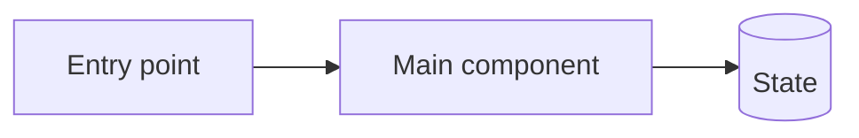

## Summary

<!-- Describe the change or problem in 1–3 short sentences. -->

## Scope

<!-- List the work and essential constraints. For bugs, include reproduction steps, environment, and relevant logs here. -->

- [ ] 
- [ ] 
- [ ] 

## Architecture

<!-- Replace the example with a compact Mermaid diagram of the affected components and data flow. Keep supporting text short. -->

## Notes

<!-- Add brief caveats, dependencies, or related issue links. -->
