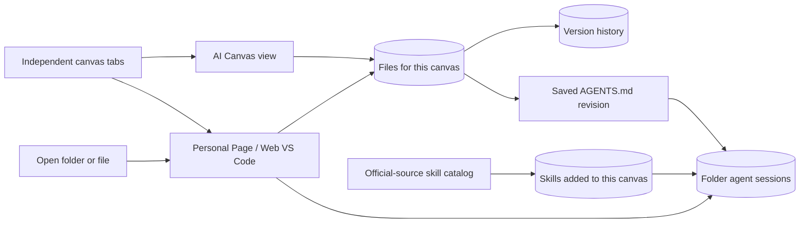
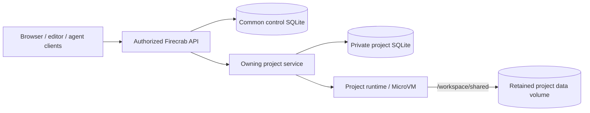

# AI Canvas implementation plan

Detailed requirements and delivery order for #550. Completion is tracked in the
issue. Keep all implementation unmerged until the entire issue is implemented
and accepted.

Before runtime integration, reconcile the applicable contracts and QA requirements
in #414 and #496. Complete each phase's exit criterion before its dependent work.

## Implementation order

### 1. Persistent project workspace foundation

**Depends on:** the applicable runtime/storage contracts and handoff requirements above.

- Reuse the existing project identity and authorization model. Use SQLite for the common control DB and a separate private SQLite DB for each project's workspace state.
- Implement project DB creation/opening, versioned schemas, local-disk WAL configuration, short transactions, and bounded write/busy handling through the owning server-side service.
- Persist project, volume, runtime, and service-owner bindings. Define recovery for interrupted provisioning and fence obsolete owners during handoff.
- Bind a retained MicroBlockStorage volume at `/workspace/shared` on an explicitly selected runtime. Verify the expected volume UUID and mount before starting project tools. Make initial import/clone idempotent.
- Retain the database and volume across tab closure, API/service restart, VM stop/start, and runtime replacement. Keep the project DB queryable while the workload VM is stopped.
- Establish a coordinated database/volume checkpoint and recovery procedure before performing destructive data migrations. Use the detailed backup contract below.

**Exit criterion:** create or open a project, save a project record and a file, restart the API and VM, reopen the same project, and recover the original data and bindings. Reject access from an unauthorized project/user and fail explicitly when the retained volume is missing or mismatched. The first implementation PR targets this foundation using existing runtime/volume operations.

### 2. Authorized file APIs and version history

**Depends on:** Phase 1.

- Provide project-scoped file listing, reading, and saving against the mounted workspace. Enforce project access and path boundaries on every operation.
- Use the same authoritative file contents for the folder navigator and editor. Check the expected base revision before accepting a conflicting save.
- Add version records, file diffs, and restoration. Restoring an older version creates a new record and preserves prior history.
- Include ordinary project files, source files, `.git`, and project-root `AGENTS.md` in the appropriate retained-file/version workflows. Keep private database files outside agent/editor file access.

**Exit criterion:** read and edit a file through the API, observe the same saved content from another authorized client, reject a stale conflicting save, restore an earlier version, and retain the result after restart.

### 3. Interactive terminals and durable session recovery

**Depends on:** Phases 1–2 and the interactive Runtime PTY contract tracked in #496.

- Implement terminal create/attach/input/output/resize/terminate operations with stable project/session/runtime identities. Support multiple terminals with explicit working directories.
- Persist terminal metadata and retained output/replay cursors. Reattach to a live process after browser disconnect without creating a duplicate shell.
- Enforce project/session access and terminal input ownership for multiple clients.
- Reconcile interrupted sessions after service or VM restart. Restore durable history and report process termination accurately; do not silently replay prior commands or claim process-memory restoration.

**Exit criterion:** two authorized clients observe the same PTY, only its controller can type, resize and reconnect work, and repeated reconnects do not duplicate terminals. Verify viewer restrictions, API restart, and VM reboot as distinct cases.

### 4. Personal Page and real Web VS Code

**Depends on:** Phases 1–3.

- Add the Personal Page entry to the left navigator and support switching between the canvas and editor.
- Display a real authenticated Web VS Code integration across the Personal Page content area, with project folder access and resize/input/reconnect support.
- Open the editor from a shared-folder entry, its folder-card open button, or a file entry. Select the requested file when opening a file.
- Provide Open Folder and Back to Canvas actions.
- Preserve open files, unsaved editor buffers, and canvas layout across view changes. Persist user/tab drafts and view state with the correct project and user identities.
- Start each new canvas tab empty. Explicitly reopening an existing project reuses its DB and volume; unrelated projects remain isolated. Share saved project files while keeping user/tab drafts and view state separate.

**Exit criterion:** open a project folder in the editor, edit and save a file through the established file workflow, switch views and tabs, refresh/reconnect, and recover the intended file, draft, and layout without cross-project leakage. Record real editor evidence separately from the existing visual mockup.

### 5. Folder agents, project instructions, and Sandbox persistence

**Depends on:** Phases 1–4 and the accepted Sandbox model/task interfaces.

- Show the folder's agent sessions and ChatGPT/Claude model controls in the editor. Bind each agent to its authorized project folder and runtime.
- Expose project-root `AGENTS.md` through the navigator, shared folder, and Web VS Code using Phase 2 editing, saving, comparison, and restoration.
- Show the saved instruction revision in folder sessions and the editor. Snapshot saved rules per request, retain earlier request revisions, and exclude unsaved edits from execution context.
- Load project instructions through the adapter for each supported agent runtime. Define and verify nested instruction discovery before claiming support for it.
- Adapt the existing Sandbox module's persistence to the project DB and migrate existing records with checkpoints, validation, and interrupted-migration recovery. Keep Sandbox's task/attempt state machine authoritative; do not introduce duplicate authoritative records.
- Preserve task/attempt/runtime identities, authorization, cancellation, and reconnect behavior. Prevent duplicate task dispatch after retries or reconnects.

**Exit criterion:** a real model performs an authorized task in its bound project folder and returns the result through the existing Sandbox lifecycle. Verify instruction revision capture, cancellation/recovery, migration recovery, and rejected cross-project access for the supported runtime paths.

### 6. Official-source skill catalog and installation

**Depends on:** Phase 5.

- Add the skill store with official distribution links for OpenAI Plugins and Anthropic Skills. Distinguish plugin skill bundles from individual skills.
- Support search, source filters, and adding/removing skills in the current project's catalog.
- Download and install the selected skill through a supported runtime adapter. Record its source identity and installed revision; retain its files on the project volume.
- Let agent sessions select skills and display that selection in both the folder session and editor. Retain selections for another model as inactive after a model change.
- Load selected compatible skills for real agent requests and reconcile installation/removal after interruption. Keep installed project files separate from per-session selection state.

**Exit criterion:** install a skill from a selected official source, use it in an authorized agent session, restart and recover its installed revision and selections, and verify removal/model-change behavior. UI-only add/remove toggles do not complete this phase.

### 7. Automated backup/restore and integrated acceptance

**Depends on:** Phases 1–6. Phase 1's basic checkpoint/recovery procedure remains required before migrations; this phase automates and validates the complete system.

- Automate coordinated project SQLite/data-volume backups using the SQLite Backup API, a completed-checkpoint manifest, and the quiescing procedure below. Back up the common control DB separately.
- Restore a matched project DB/volume checkpoint on another host. Validate schema/integrity and reconcile resource bindings through the control layer.
- Verify file, `AGENTS.md`, installed skill, draft, and session recovery after browser refresh/disconnect.
- Verify API/service restart and VM stop/start independently. Replace a VM and reattach the retained volume without losing files or confusing runtime identities.
- Verify concurrent access, write contention, ownership handoff, and rejection of cross-project access.
- Test interrupted provisioning, database migration, skill installation, backup, and restore.
- Verify explicit data deletion and retention boundaries for tab closure, session termination, VM deletion, project archival, and permanent data deletion. Preserve borrowed resources and retained data.
- Record real multi-client, editor, agent, runtime, and storage evidence for the integrated workflows. Keep mockup/fixture checks distinct from live acceptance.

**Exit criterion:** recover a complete project from a matched backup and demonstrate the supported end-to-end workflows and failure cases. Record remaining unsupported cases explicitly before accepting the issue.

## Architecture

The mockup manages files and edit buffers within each canvas tab's iframe. Reopening Personal Page reuses the editor instance. The project skill list belongs to that canvas, while skill selections belong to individual agent sessions.

### Project SQLite and persistent workspace design

This section describes the intended backend. The current iframe mockup does not implement durable storage or runtime recovery.

#### Storage ownership

Use SQLite for Firecrab-owned control and workspace data. A project's application database remains a separate project resource and can use the engine that application requires.

| Store | Responsibility |
| --- | --- |
| Common control SQLite DB | Users, access grants, project registry, resource ownership, runtime/volume bindings, and routing to the project service |
| One private SQLite DB per project | Project conversations, sessions, task/attempt records through the Sandbox persistence layer, user/tab drafts and layouts, skill selections, instruction revisions, and retained event/replay metadata |
| One retained data volume per project | Source files, `.git`, `AGENTS.md`, installed skill files, and retained artifacts/log files |

Keep the project database in a server-only path such as `<private-data-root>/projects/<project-id>/project.db`. The common database remains `firecrab.db`. The existing volume backing-file layout is `<storage-root>/volumes/<volume-id>/data.ext4`. Project code and agent shell sessions do not receive direct access to the private database files.

Project identity, rather than a browser tab or transient VM ID, owns the database and volume. Closing a tab or replacing a VM retains both. An empty new tab attaches to an existing project's storage only after that project is explicitly opened.

#### Database access and state ownership

- Keep each database on local durable storage. All database access runs on its owning host through the API; clients do not open a shared SQLite file over a network filesystem.
- Use WAL mode, `synchronous=FULL`, foreign-key enforcement on each connection, short transactions, and bounded busy/retry handling. Batch streaming output instead of committing every token or terminal byte. SQLite permits one writer at a time per database file. See [SQLite WAL](https://sqlite.org/wal.html).
- Use one active owning project service with fencing during handoff so an obsolete owner cannot continue accepting writes. Multiple browser users can share that service.
- Keep authorization and resource ownership authoritative in the control layer. Keep Sandbox responsible for its task/attempt state machine while adapting its storage to the project database. Any control-layer summaries are derived indexes, not a second authoritative task state.
- Version project schemas and define migration/rollback recovery before moving existing records. Cross-database updates are not a single atomic transaction; reconcile provisioning and migration using stable IDs and persisted operation state.
- Keep the project database readable through the API while its workload VM is stopped.

#### Volume lifecycle and reconnect

- Initially use one active workload VM per project. Multiple users, terminals, and agents connect to that runtime. Respect the existing volume's single-VM attachment rule.
- Create or reserve the project's volume, attach it while the VM is inactive, then verify the expected volume UUID and mount before starting Web VS Code or agents.
- Import or clone the authorized project only during initial workspace provisioning. Make initialization idempotent. A missing or mismatched retained volume fails startup; it must not be silently replaced with an empty workspace.
- Reuse the same volume when restarting or replacing a runtime. Stop the previous owner and release its attachment before handing the volume to another VM.
- Separate tab closure, session termination, VM deletion, project archival, and permanent data deletion. Retain project data until its explicit retention/deletion policy authorizes removal.
- A browser reconnect can reattach to a live process. After a VM reboot, recover files and durable session history, then reconcile interrupted work. Reopening a terminal does not restore its former process memory or replay prior commands automatically.

#### Backup and restore contract

Use the [SQLite Backup API](https://sqlite.org/backup.html) to create a consistent database backup. Start with a coordinated offline project checkpoint: suspend new project mutations, stop the workload VM, drain in-flight project writes, then back up the project database and retained volume. Record a manifest with project/volume identities, schema version, checkpoint identity, and integrity hashes. Resume the project only after the checkpoint is complete or the failed checkpoint has been reconciled.

A database backup alone does not establish a matching file-volume recovery point. Back up the common control DB separately. A project restore validates or re-registers its resource bindings through the control layer and restores the database and volume from the same completed checkpoint. Cross-host recovery additionally requires transferring or restoring the retained data; it is not an automatic consequence of a local volume.

The ordered delivery and acceptance gates are listed in Scope above. The final integrated phase adds automation and end-to-end evidence to the basic checkpoint procedure required by Phase 1.

Existing foundations are documented in `public-docs/guides/volumes.md` and `public-docs/guides/storage.md`. Canvas integration, per-project database migration, automated backups, and end-to-end recovery remain implementation work.

## Notes

- Related parent work: #496.
- Real runtime integration follows the implementation and QA order in #496 and #414. This mockup does not satisfy those acceptance gates.
- Mockup files: `assets/dashboard/ai-canvas/spatial-workspace-mockup.html` and `assets/dashboard/ai-canvas/spatial-workspace-view.html`.
- Official skill sources: [OpenAI Plugins](https://github.com/openai/plugins) and [Anthropic Skills](https://github.com/anthropics/skills). The catalog links to these sources and labels the intended runtime.
- Browser checks covered automatic folder opening, opening a specific file, preserving unsaved edits across view changes, adding a version after a mock save, and isolating state across canvas tabs.
- Skill-store checks covered search, source filters, project add/remove actions, session selection, model changes, and separate skill lists for new canvas tabs. JavaScript syntax checks also passed.
- `AGENTS.md` checks covered opening the file from the navigator, preserving unsaved edits, recording a version on save, retaining the saved rule revision on each mock request, comparing/restoring rule versions, and separate rules state across canvas tabs.
- The instruction mockup covers the project-root file. Actual runtime loading and nested instruction discovery remain follow-up work. See the [official AGENTS.md guide](https://learn.chatgpt.com/docs/agent-configuration/agents-md) for the Codex convention.
- The mockup does not run a VS Code server, terminal commands, AI API calls, MicroVMs, or skill downloads/installations. Example state resets on page reload.
- The [screenshot comment](https://github.com/SteelCrab/firecrab/issues/550#issuecomment-6510124559) shows the Personal Page editor mockup.
