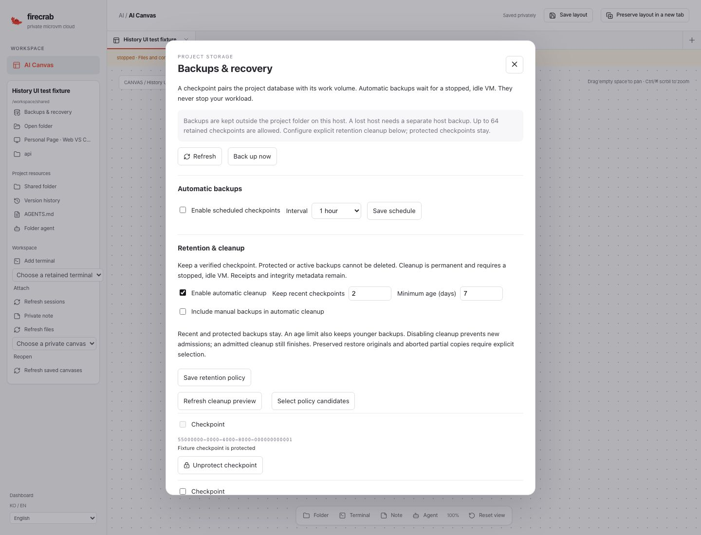
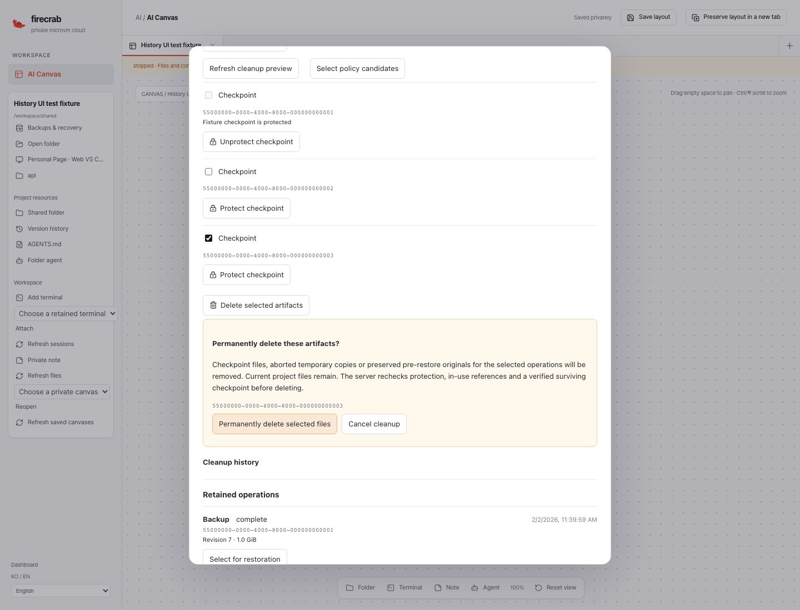

# Project backup retention and cleanup — 2026-11-04

Delivery: [#550](https://github.com/SteelCrab/firecrab/issues/550),
[Draft PR #562](https://github.com/SteelCrab/firecrab/pull/562),
`feat/550-ai-canvas` → `release/v0.5.0`. Keep the PR unmerged until all issue
implementation and acceptance work is complete.

## Behavior

[Operator/API/recovery guide](../guides/project-backup-retention.md) describes the
explicitly enabled count/age policy, manual-backup exclusion, checkpoint protection,
preview, irreversible confirmation and exact-ID recovery.

- Admission verifies a separate complete checkpoint before deleting completed archive
  or original files. Protected/in-use checkpoints and changed resource bindings fail
  closed. Aborted pre-installation copies use their separate explicit cleanup path.
- The controller atomically journals the private file plan and target tombstones
  before unlinking. Current project/volume files and live task identities remain.
- Per-file checksums and file identities support restart after partial deletion.
  Unknown entries and symlink/hard-link aliases reject the plan. No recursive delete.
- Receipts and manifests remain after bytes are removed. Completed retry returns
  the old receipt without deleting newer files. Generation acknowledgement remains
  enforced after original-file cleanup.
- The real React controls support English/Korean, protection, policy previews,
  explicit target confirmation, uncertain responses and server-side resume receipts.

The control schema is additive. Existing backup records default to unprotected with
no cleanup intent; enabling the new code alone admits no automatic deletion. Existing
backup archives and legacy checkpoint/migration sources remain readable.

## Validation

Behavior tests cover count/age opt-in, manual exclusion, protection, last valid
checkpoint, corrupt alternatives, wrong generation/permissions, changed/aliased
files, aborted backup/restore staging, service-owner exclusion, partial unlink across
controller startup and a crash after the cleanup control commit.

Compiled UI tests verify explicit confirmation before any deletion, protection,
Korean minimum-retention validation, pending gate cleanup and an uncertain deletion
response across reload with the same UUID/target list. These screenshots use a
synthetic controller; they do not establish live VM or provider acceptance.

The Linux component QA restores actual ext4 contents and SQLite bytes, then removes
only the preserved original files while keeping the live filesystem, project revision
and verified checkpoint. `mkfs.ext4`, `debugfs` and `e2fsck` run in an owned disposable
container. No user VM or host service is restarted.

Local validation passed **18 backup/cleanup API regressions** on macOS and **18 passed,
0 failed, 1 environment-gated test ignored** on Linux UID 65534. The two explicitly
invoked native Linux QA tests passed, including the separately gated real ext4 test.
The final React suite passed **162 / 0 failed**, and all **13 targeted backup/cleanup
unit and compiled-browser tests** passed after the policy-selection fixture update.
Formatting, API Clippy with warnings denied, frontend lint/build, documentation links
and product-version checks passed. Existing unrelated frontend lint warnings remain;
no new backup/retention lint warnings are present.

Exact-head CI/Codecov links and final hosted outcomes are recorded in the PR progress
comment. CI success alone does not complete the live acceptance gates below.

## UI evidence

These are the compiled React controls with a synthetic controller.

## Open acceptance

Genuine different-host restoration, real ChatGPT/Claude workload use, production
service-user/multi-user qualification, native editor lifecycle/replacement and live
backup/cleanup interruption remain open. The test Pipe AI connection is unavailable.
No production backup files were deleted. PR #562 stays Draft and unmerged.
