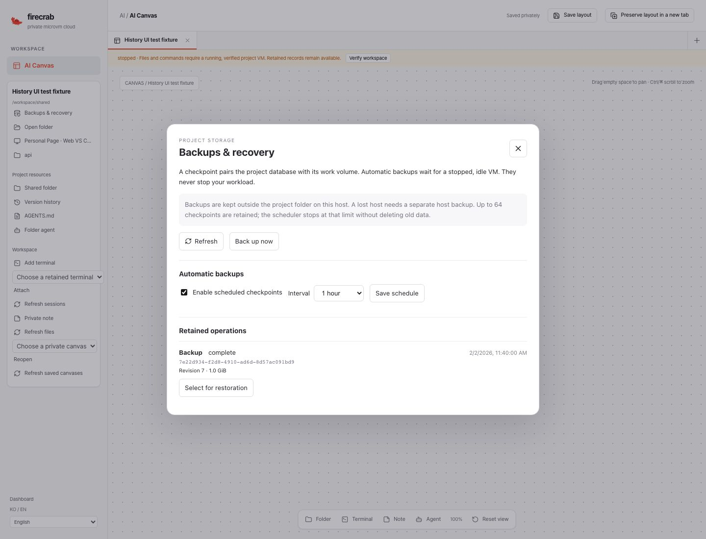
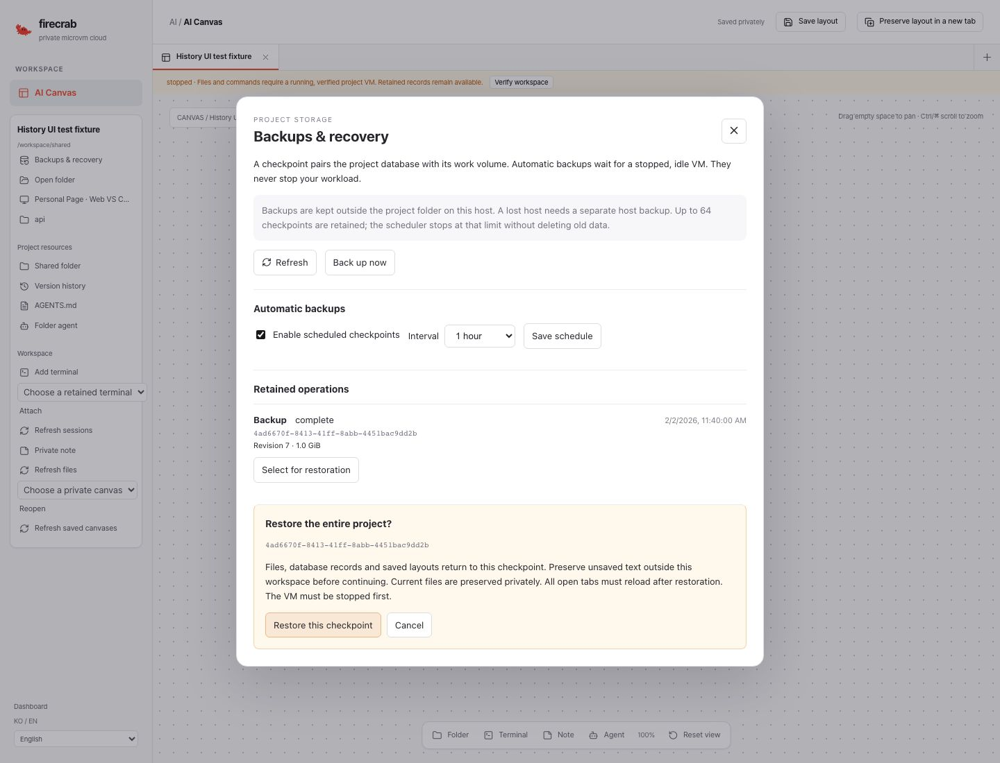
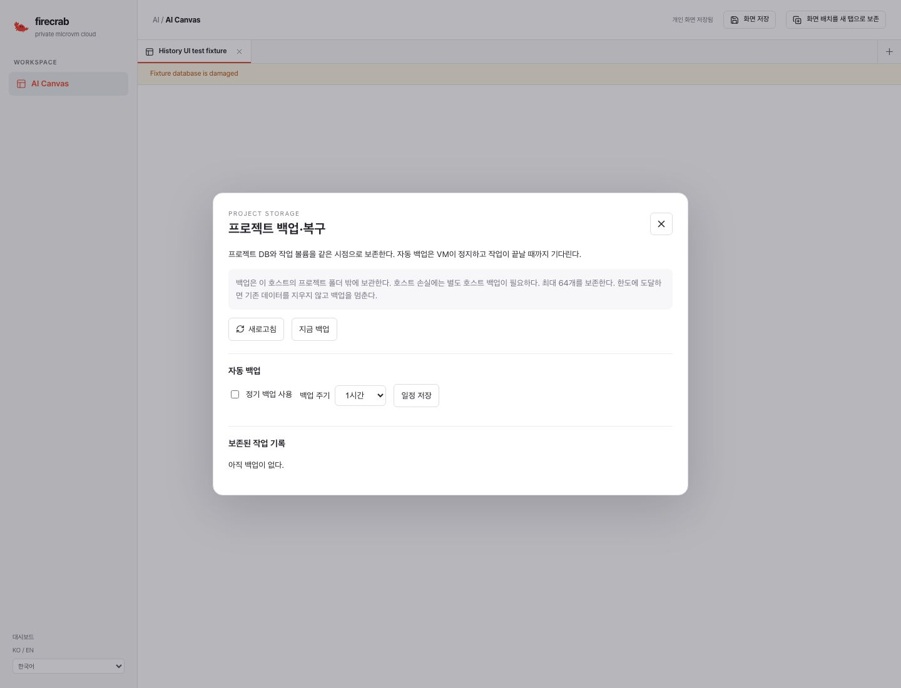

# Project backup and restore implementation — 2026-11-02

Delivery: [#550](https://github.com/SteelCrab/firecrab/issues/550),
[Draft PR #562](https://github.com/SteelCrab/firecrab/pull/562),
`feat/550-ai-canvas` → `release/v0.5.0`. No merge or deployment is authorized.

## Implemented behavior

[Operator/API/recovery guide](../guides/project-workspace-backups.md) describes the
opt-in offline scheduler, independently retained project/volume/control DB archive,
restart reconciliation, original-file preservation, per-project durable fence,
permanent service ownership and post-restore generation acknowledgement.

The compiled dashboard includes English/Korean backup controls, operation history,
explicit whole-project restoration confirmation and retained uncertain-request retry.
Recovery controls remain available when project DB connection fails.

## Evidence

- Codecov on preceding transport commit `c0594e0fe8d30d1f19bf247e4b298f2f277fad8d`
  passed at **86.28%**, with the existing **80%** target unchanged.
- Selected final workspace regressions: **100 passed, 0 failed**, with two explicitly
  gated environment tests skipped. New backup regressions exercise real SQLite and sparse disk fixture bytes:
  paired restoration, stale HTTP write denial, completed retry, restart after only
  the DB replacement, missing DB directory/disk, corrupted archive refusal,
  pre-installation abort, scheduler deferral, permissions/input validation, canonical
  Sandbox DB loss, permanent service-owner exclusion and concurrent schedule edits.
  Source health and pending native writes are checked before scheduling can fence VM
  startup. Six recovery browser regressions distinguish fresh definitive rejection
  from earlier uncertain outcomes and verify committed cleanup remains resumable.
- Full frontend suite: **154 passed, 0 failed**. Compiled browser tests cover schedule editing, backup creation, explicit restoration
  with a damaged DB, and identical request retry after a browser reload. Screenshots
  use an explicit synthetic controller and do not establish live VM or provider use.
- Editor bridge tests verify the workbench generation travels on file/private-buffer
  requests. A request-layer regression ensures polling cannot silently authorize an
  older tab against restored data.
- Linux aarch64 container QA: **2 passed, 0 failed**. The native SSH/OpenVSCode
  transport and the separately opt-in real ext4/SQLite backup round trip passed in
  `scripts/test-project-workspace-transport.sh`, using `mkfs.ext4`, `debugfs` and `e2fsck`. It has
  no external network or published ports at runtime. It does not mount/boot a user VM.

Rust formatting, API Clippy with warnings denied, public documentation links, product
version consistency, shell syntax and ShellCheck passed locally.

Early preparation exposed a macOS parent-path alias under SQLite NOFOLLOW, a missing
controller-task lookup during DB-loss recovery, and a router-selection error in the
new generation test fixture. These were corrected before delivery. No test threshold,
coverage exclusion or production identity check was weakened.

A broad API run on macOS passed 1,490 tests and failed 272, with 23 ignored.
It is not a valid full Linux acceptance run: failures include Linux descriptor/path
semantics, missing `mkfs.ext4`, `/proc` process checks and Linux guest tooling. The
selected cross-platform workspace regressions and actual Linux component QA above
are separate evidence. Full-suite acceptance must come from the hosted Linux jobs.

## Additional CI regressions

The preceding release run failed a one-shot Windows dashboard identity probe under
runner load. The test now retries only the same exact session identity for a bounded
period. It still rejects foreign/copied sessions. The preceding Linux runtime CI
failed because the pool list rendered **New pool** before the first response, then
removed it when the empty-list creation form arrived during the click. The dashboard
now waits for the initial list before offering that button. A delayed-response browser
regression verifies this behavior. Assertions and pool mutation coverage remain intact.

Live workload interruption, different-host restore, production-user/multi-user checks
and retention/deletion remain unchecked. PR #562 stays Draft and unmerged.

A later release-profile CI run exposed a direct fixture mutation racing the task
worker's admitted-state checkpoint. The fixture now owns the existing admission
claim only around its direct database edits. Public retry still acquires its own
claim. All original frozen-rule, attempt identity and no-dispatch assertions remain.
The exact regression passed locally and passed ten additional exact executions.

## UI evidence

These screenshots use a synthetic controller in the compiled React app. No live
workload, provider or user database is represented.

