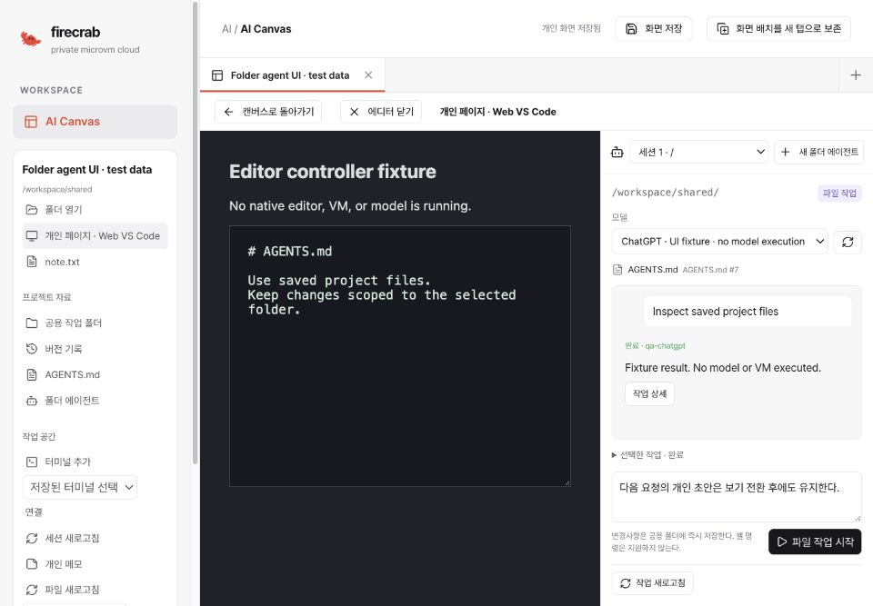

# Folder agent sessions — 2026-11-02

Issue: [#550](https://github.com/SteelCrab/firecrab/issues/550). Delivery:
[Draft PR #562](https://github.com/SteelCrab/firecrab/pull/562), targeting
`release/v0.5.0`. The PR remains unmerged, with auto-merge disabled. This report
covers partial implementation, not complete issue acceptance.

## Implemented behavior

- Folder-bound file-agent cards in Canvas and the same sessions beside Web VS Code.
- Explicit ChatGPT/OpenAI and Claude account/model selection, authorized metadata,
  existing verification proofs, explicit catalog refresh and tool verification.
- Private request drafts and exact pending task/snapshot IDs saved before dispatch.
- Read-only task lookup on reconnect; explicit retries preserve the original IDs/body.
- Saved instruction versions, retained conversation pages, task events and file-history links.
- Existing Sandbox cancellation and receipt-only reconciliation. Closing a visual
  panel or switching views never cancels a task or silently dispatches another one.
- Invalid saved sessions refuse model discovery, task queries and dispatch.

No second authoritative task state machine, provider-key storage, host-source copy
or hidden model fallback is introduced. The [operator and API guide](../guides/sandbox-folder-file-agents.md)
describes the supported file-only profile and its limits.

The feature branch also follows the release branch's separate revert of premature
#559 integration. It preserves Canvas retained-data deletion guards, project DB
routing and task-catalog cleanup. It does not restore the reverted IaC implementation.

## Local verification

- API regression selection: **120 passed**, including model-list authorization,
  folder runtime/receipt fencing, saved instructions, project DB migration, editor
  lifecycle, retained-data delete rejection and legacy task-catalog cleanup.
- API and API-types Clippy, all targets with warnings denied: passed.
- Agent request/reconnect Node tests: **10 passed**.
- Frontend type check, production build and lint: passed. Existing warnings remain
  outside the changed Canvas files.
- Documentation links, language checks, product versions and diff whitespace: passed.
- Five hosted browser regressions are authored for the existing Frontend CI job.
  A standalone local Playwright browser was not launched.

An initial broader Rust selection on macOS passed 155 tests, failed 16 and skipped
six explicit Linux guest QA tests. The failures are existing host filesystem/Git
snapshot tests that require Linux descriptor/path behavior; examples use
`/proc/self/fd`. They are not recorded as passing or disabled. Hosted Linux CI must
validate those paths. The final 120-test selection covers this implementation's
platform-independent regressions and passes without skips.

## Browser evidence

The compiled React app was exercised in the in-app browser against an owned
loopback-only synthetic controller. Neither a provider nor a native workload VM
was executed. The editor pictured below is an explicitly labeled controller stub,
not OpenVSCode acceptance evidence.

The fixture observed exactly one ChatGPT task after save/reload and editor/canvas
switching. An explicit subsequent Claude request created exactly one second task.
The original request retained its model and saved rule revision. A new canvas tab
had zero agent sessions. English and Korean controls rendered correctly. Desktop
layout placed editor and session side by side; the narrow layout stacked them.

## Remaining acceptance

Phase 5 remains open. Real connected ChatGPT/Claude execution, full folder shell
execution, native lifecycle/replacement and multi-user qualification are pending.
No test Pipe AI connection is available. Official-source skill installation,
automated matched backup/restore and cross-host restore remain later #550 work.
No production data migration, deployment, integration-branch merge or PR merge
was performed.
