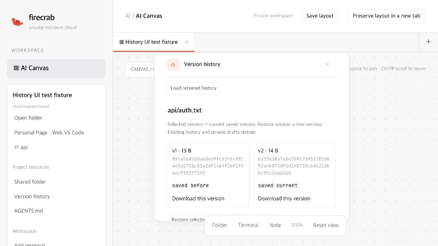
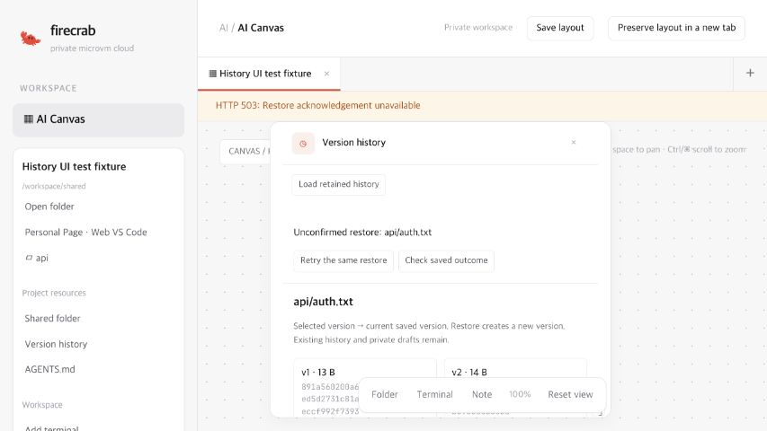
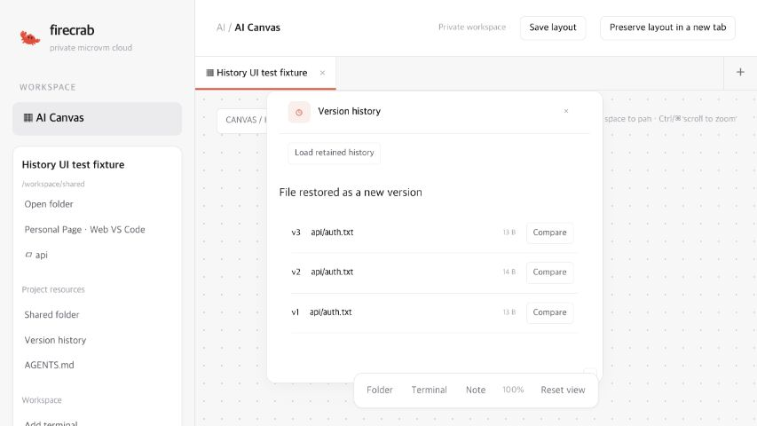

# Canvas history UI validation — 2026-11-01

This report covers a #550 implementation slice. It does not accept the complete issue. PR #562 remains draft and must not be merged before full implementation and acceptance.

## Scope and provenance

The browser used the actual compiled Rust/WASM Canvas with a stateful controller fixture. The fixture uses generated file contents and in-memory receipts. It does not use a workload VM, execute a model, or change a real project folder. Earlier live file/editor recovery evidence remains separate.

- Canvas source digest: `a4f34c6d947bb7f8b03e2dd6f1ea315bc332e19bfde4b9b46ab6f78624b46a8c`.
- Compiled Canvas WASM SHA-256: `24b82a1236f37f3fe942ca3d1c771ecc43269963ad591bbd6fdb346ca26d2462`.
- Browser capture used the default viewport. A canvas pan exposed the panel controls.
- The final build used the same comparison/restore contract as the regression fixtures in `firecrab-frontend/tests/canvas-fixture.mjs` and `canvas.test.mjs`.

## Observations

| Gate | Result |
| --- | --- |
| Read selected retained text beside current saved text | PASS in browser fixture |
| Stale base after another saved change | PASS: HTTP 409, zero accepted restores; no automatic rebase |
| Lost acknowledgement after accepted restore | PASS: HTTP 503 leaves an unconfirmed request and disables a new restore |
| Explicit retry | PASS: two byte-equivalent JSON requests use the same operation UUID and saved base; one accepted file change |
| Append-only restore | PASS: v1 restored as v3; earlier v1 and v2 retained |
| Record pagination | PASS: first 100 rows, then 108 total rows without duplicates |
| Browser reload | PASS: same private canvas reopens, first 100 records reload, restore count remains one |
| Korean/English labels | PASS in the browser comparison/restore slice |

The final source repeated the HTTP 503/retry and pagination/reload gates. The concurrent-change gate was observed before the pagination-only change. The version comparison and restore handlers were unchanged between those observations.

## Local commands

- `CARGO_INCREMENTAL=0 cargo test -p firecrab-api project_workspace --locked`: PASS, 49 tests, including saved instruction context and pending-operation ordering.
- `CARGO_INCREMENTAL=0 cargo test -p firecrab-api guest_transport_pins_the_selected_vm_and_refuses_a_changed_boot_or_stopped_vm --locked`: PASS.
- `CARGO_INCREMENTAL=0 cargo clippy -p firecrab-api -p firecrab-api-types --all-targets --locked -- -D warnings`: PASS for the saved-instruction slice.
- `CARGO_INCREMENTAL=0 cargo test --manifest-path firecrab-frontend/Cargo.toml --locked`: PASS, 205 tests.
- `CARGO_INCREMENTAL=0 npm --prefix firecrab-frontend run lint`: PASS.
- `CARGO_INCREMENTAL=0 npm --prefix firecrab-frontend run build`: PASS.
- `python3 scripts/check-doc-links.py`: PASS.
- New browser regression files: syntax checked; the automated browser suite was not run locally because its Playwright dependencies are absent. Browser observations above used the computer-use browser with the same stateful fixture.

An extra frontend `clippy --all-targets` check reports existing test-only lint failures in `forms.rs`, `terminal.rs`, and `tests/unit/sandbox/mod.rs`. The required frontend lint command passes. No lint rule was disabled.

A local repeat of the staged Linux checks did not start because the earlier Docker build image and cache no longer exist. This is not a Linux pass. Hosted checks must verify the new revision. No CI threshold was lowered.

## Screenshots

These images show test-fixture data, not a live project or a provider-backed agent.

Remaining #550 acceptance includes editor-session cleanup, project-local Sandbox task migration, provider-backed folder agents, official skill installation, automated matched backups and cross-host restore. No test Pipe AI connection is currently available.

## Approved work-branch baseline update

After explicit user approval, main `5bba54f6ce775fb50aa820d881c5627ce62424b7` was synchronized into the #550 work branch only. The main branch and PR merge state were not changed. Main's unrelated feature reversions were preserved.

Post-update checks pass: API/types clippy, 49 workspace tests, 205 frontend Rust tests, required frontend lint/build, and documentation checks. A fresh browser fixture confirms 19 dashboard menu entries, the AI Canvas link, project opening, file comparison, and a single append-only restore.

Post-update compiled Canvas WASM SHA-256: `7647e2326e2ce6dc359cf0c61cd3a1a297f56f7847cbcf855af3d5709038f5f8`.

## Retained-instruction API and CI follow-up

The stopped-runtime instruction route now has HTTP-level regression coverage. An accepted snapshot can be read and replayed while the VM is stopped. A different operator identity cannot read it. Changing its selected directory conflicts, a new capture cannot start against a stopped VM, and access revocation denies a later read. Supplying a caller or forged rule payload is rejected with a JSON error. All 51 workspace tests and API/types clippy pass locally after this change.

On `0b632114`, hosted frontend CI passed the stale-restore and identical-retry browser regressions. Its reload regression failed because it reloaded before the private canvas layout was durably accepted. The fixture now exposes accepted private views so that test waits for the saved history panel before reloading. The assertion remains enabled, and no timeout, lint, or coverage threshold was relaxed. The updated hosted run must verify the fix.
