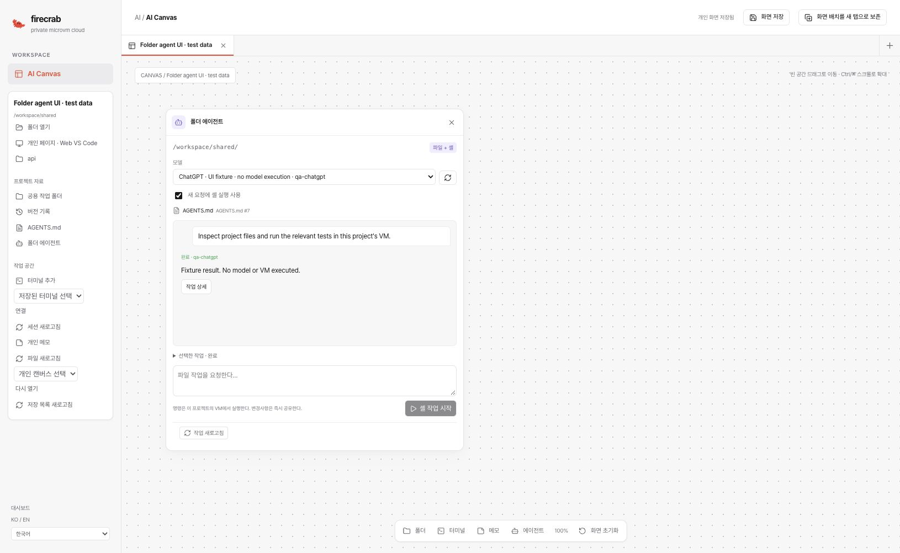

# Project-folder shell implementation — 2026-11-02

Issue: [#550](https://github.com/SteelCrab/firecrab/issues/550). Delivery:
[Draft PR #562](https://github.com/SteelCrab/firecrab/pull/562), targeting
`release/v0.5.0`. Work stays on `feat/550-ai-canvas`. The PR remains unmerged,
without auto-merge. This report records partial implementation, not final acceptance.

## Baseline CI

The preceding exact head `46c258f2becbf4b1d1b80356a8d30eb283f73147` completed
[CI](https://github.com/SteelCrab/firecrab/actions/runs/41399462263) and
[Release Build](https://github.com/SteelCrab/firecrab/actions/runs/41399462153)
successfully. No failing GitHub Actions job remained on that head. The external
[Codecov patch check](https://app.codecov.io/gh/SteelCrab/firecrab/pull/562) failed;
its coverage threshold has not been changed. Baseline results do not qualify the
new implementation until its own workflows finish.

## Implemented behavior

- Explicit `projectShell:true` request capability, disabled by default. Existing
  serialized file-only requests keep their admission identity.
- Canvas and Personal Page controls save that capability with the original private
  request checkpoint. A pending request cannot change capability on retry/reload.
- The existing Sandbox task/attempt/event lifecycle admits literal `run_argv`
  commands in the retained project VM. No host command or source-copy staging is used.
- Native project/database/volume/import proof, fixed operation IDs, immutable payload
  receipts, fresh unprivileged command UIDs and clean explicit environments.
- Kernel CPU, memory, process/file/descriptor limits, wall deadline, separate capped
  stdout/stderr, cancellation and detached-descendant cleanup.
- Durable command observations cannot launch missing commands. Retrying an accepted
  launch cannot repeat it. Cancel-before-arrival creates an exact tombstone.
- Supervisor loss retains partial output and unknown completion. Boot/process proof
  prevents cancellation from signaling a reused current-boot UID/PID.
- After stop/start and explicit workspace reconciliation, the same verified
  database/volume/VM/binding generation may recover old receipts through observation
  or cancellation. A new boot cannot launch the original request. Another VM or
  generation remains rejected until the original pending task is settled.

The [command and recovery guide](../guides/sandbox-project-shell.md) describes the
contract and limits. Commands change shared files immediately. They are not a
filesystem transaction, per-write version receipt or filesystem jail. The selected
folder is the starting directory. Existing VM Execute permission is required.
Interactive and long-running work continues to use project PTY terminals.

## Local verification

- Selected API/API-types regressions: **125 passed, 0 failed, 0 ignored**. They cover
  shell opt-in, literal protocol bounds, process/output reply validation, immutable
  admission, same-binding boot recovery, saved rules, migration and workspace lifecycle.
- API/API-types all-target Clippy with warnings denied: passed.
- Agent request/reconnect Node tests: **12 passed**. Frontend type/production build
  and lint passed; existing unrelated warnings remain.
- Native Linux command tests: **10 passed**. Existing native PTY tests: **11 passed**.
  These execute actual unprivileged processes in an owned disposable root container,
  with source mounted read-only, no network and temporary project data. They do not
  start or change a user VM, installed service or production project.
- Native tests include raw stdin, literal arguments, distinct streams/exit status,
  enforced limits, retained identity, late cancellation, detached descendants,
  sibling isolation, supervisor loss and running/interrupted old-boot receipt cleanup.
- The full static aarch64 musl helper build passed. The production build retains
  license verification; no assertion or threshold was disabled.
- Documentation links, language/product-version checks and diff whitespace passed.
- A sixth hosted browser regression is added to the existing Frontend CI job.
  Its latest-head result must be checked separately after push.

## First latest-head CI and documentation fix

The initial shell implementation `4eb25d45` passed the hosted Frontend job with
**139 tests, 0 failures**, including the new shell capability/reload regression.
Its rustdoc job failed the unchanged 75% completeness floor at **74.9899%**.
The new command receipt fields, wire functions and shell lifecycle adapter now
have substantive documentation. Both new Rust modules report **100%** item
documentation coverage locally; API/API-types documentation builds with warnings
denied. A complete workspace documentation build on macOS is unsupported because
its Linux-only `netlink-sys` dependency does not compile there. Linux CI must verify
the complete workspace floor on the final head. No threshold was lowered.

## Browser evidence

The compiled React dashboard was exercised in a dedicated Chrome task tab against
an owned loopback-only synthetic controller. Shell starts disabled. Enabling it,
submitting once and reloading retained both `projectShell:true` and the saved
session capability with exactly **one admission**. Korean controls also rendered.
The visible result explicitly says that no model or VM executed.

## Remaining acceptance

Real ChatGPT and Claude execution through a workload VM is pending because the test
Pipe AI connection is unavailable. Native helper tests are not workload-MicroVM,
production-user, browser shutdown, runtime replacement or multi-user acceptance.
A stopped VM supplies no fresh output; accepted task events remain queryable from
its retained project DB. Live full lifecycle/replacement acceptance remains open.

Official-source skill installation, automated matched backup/restore and cross-host
restore remain later #550 work. No production migration, deployment, tag, release,
integration-branch merge or PR merge was performed. Phase 5 remains unchecked.
