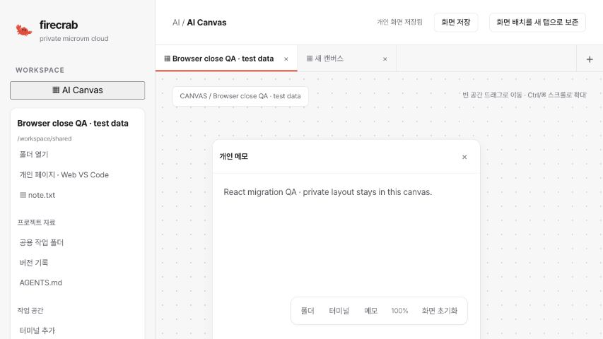

# Canvas React dashboard integration — 2026-11-02

Issue: [#550](https://github.com/SteelCrab/firecrab/issues/550). Implementation:
[draft PR #562](https://github.com/SteelCrab/firecrab/pull/562). Do not merge until
all issue requirements and live acceptance checks are complete.

## Result

The work branch incorporates main's React dashboard migration without restoring
the deleted Rust/WASM frontend. Canvas uses the existing project APIs and private
SQLite views. It preserves independent blank tabs, retained private layouts,
folder navigation, notes, version comparison/restoration and the Web VS Code
client lifecycle. Project setup remains an operator API workflow documented in
the [workspace guide](../guides/project-workspaces.md).

The terminal adapter uses the dashboard's xterm engine. Each view has its own
attachment, lease, stream epoch and byte cursor. Reconnection does not replay
input. Server terminal dimensions remain authoritative. Native iframe portals
remain outside React reconciliation until the private client detach receipt.

The Sandbox migration moves canonical task, attempt and admission data into the
project database. See the [operator migration procedure](project-sandbox-migration-2026-11-01.md).

## Local verification

- Frontend production build and type check: passed.
- Frontend lint: no errors or Canvas warnings; main has existing warnings.
- Editor protocol and pane ownership Node tests: 24 passed.
- Rust persistence migration tests: 16 passed.
- Project workspace tests: 68 passed.
- Service recovery tests: 18 passed.
- API/API-types Clippy with warnings denied: passed.
- Rust formatting and documentation links: passed.

The browser tests are authored for hosted CI. They were not run using a local
standalone Playwright process. Hosted terminal coverage exercises two sessions,
control acquisition, output replay deduplication and reconnect without input replay.

## Browser evidence

The compiled React UI was exercised through the in-app browser against an owned,
loopback-only synthetic controller fixture. No native editor, VM or model was run.
A private note and folder survived save/reload. A second tab started empty. The
Korean locale rendered correctly. Closing the editor retained the same iframe URL
until the fixture acknowledged one close command and one private snapshot. The
fixture recorded no global editor stop. Only then was the iframe removed.

## CI and remaining acceptance

Before the main refresh, commit `0f910956` passed both complete
[CI](https://github.com/SteelCrab/firecrab/actions/runs/41317688805) and
[Release Build](https://github.com/SteelCrab/firecrab/actions/runs/41317691274),
including Installer's real Linux/KVM and Nginx checks. The work-branch merge needs
fresh complete workflows; those results are recorded on the PR.

This report does not establish live project migration or matched cross-host
restore, stopped-VM task querying on a production service UID, native editor
shutdown, or real ChatGPT/Claude execution. Those acceptance checks remain open.
No production database migration, public release, deployment or PR merge occurred.
