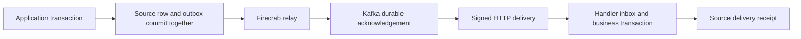

# Database services and reliable events

PIPE connects PostgreSQL and MySQL to MicroServices. Existing connections stay read-only. Enable writes explicitly before editing rows, creating write bindings, or installing change capture.

## Normal setup

1. Save the database URI and, when required, its CA certificate.
2. Select a stopped service and read or write access. Firecrab creates a separate account and injects its connection on deployment.
3. For change handling, prepare Kafka once, then select a source table and handler service. The default endpoint is `/events/database`.

Topic names, TLS certificates for managed Kafka, capture objects, signing keys, retry intervals, inbox tables, and checkpoints are generated automatically. Advanced controls remain collapsed in the dashboard.

The setup account needs privileges to create the internal namespace, row triggers and service accounts. Its privileges are not granted to the service. Existing accounts are never widened. Missing privileges fail setup and leave a retryable intent.

## Architecture

Capture runs in the source transaction. A database rollback also removes its outbox entry. Kafka or handler downtime does not prevent the application transaction from committing.

The relay reads the oldest visible unfinished event for each trigger. It acknowledges Kafka before storing its offset. It verifies the stored Kafka record before delivery and republishes the source copy if the record is missing. The source payload remains available after delivery. Advisory locks prevent competing relays for one trigger. Concurrent source transactions do not provide a global commit-order guarantee.

Delivery is **at least once**. HTTP success followed by a process failure can repeat delivery. The stable ID is `<trigger UUID>:<outbox ID>`. Only HTTP 2xx marks an event delivered. Each service receives a private HMAC signing key. Verify the timestamp, signature and event ID before processing the body.

Write bindings include a private `FIRECRAB_INBOX_TABLE`. The example in `examples/database-events` inserts the event ID and applies business changes in the same DB transaction. Repeated committed events skip the business callback. External effects, such as HTTP requests, need their own idempotency keys.

## Database writes and permissions

- Row metadata identifies defaults, generated columns, binary values and composite primary keys.
- Updates and deletes use the original primary key and SHA-256 row fingerprint. A stale row returns a conflict.
- A request UUID, payload hash and receipt commit with the row change. Retrying the same request returns its saved receipt. A different payload cannot reuse the UUID.
- Cell input is text or SQL NULL. JSON input is raw JSON text; JSON `null` and SQL NULL remain distinct. Bound parameters carry values. Only quoted, inspected identifiers form SQL.
- Generated columns, primary-key changes, spatial edits and nontransactional tables are rejected. Rows with truncated keys cannot be edited in the console.
- Service accounts receive SELECT or SELECT/INSERT/UPDATE/DELETE on application tables. Write accounts can insert inbox event IDs. Account creation and schema maintenance remain operator functions.
- Credentials and signing keys stay in private SQLite records and the guest's root-readable `vm.env` file. Public API responses and VM metadata exclude them. CA files are readable by the application user.

PostgreSQL capture uses an owned trigger function. MySQL requires InnoDB and rejects generated/binary/spatial capture columns. MySQL foreign-key cascades and SET NULL do not fire row triggers, so affected tables are rejected. Use explicit application writes for these cases. Table renames outside managed maintenance require capture to be recreated.

SQL numeric columns are represented as strings in event row images to preserve integer and decimal precision. JSON columns retain their native JSON representation. Choose a suitable JSON parser when an application needs arbitrary precision inside JSON documents.

## Kafka and failure recovery

Managed Kafka uses the official Apache image pinned to its resolved digest. The normal profile creates three broker/controller MicroVMs with mutual TLS, replication factor 3, minimum ISR 2, and unclean leader election disabled. Each broker uses 1536 MiB RAM and a persistent 10 GiB VM disk. Stop/start reuses that disk. Startup recovery and health supervision restart owned brokers.

All local brokers share one host. Host failover needs an external Kafka cluster. An explicit development profile uses one broker and cannot tolerate loss of that broker's data. Capacity checks reject insufficient memory or disk space before setup.

External Kafka supports verified TLS, optional mutual TLS, and SASL/PLAIN over TLS. Configure the external cluster with durable replication and minimum ISR 2. Production setup requires three bootstrap addresses and creates topics with three replicas. Existing unrelated topics are not adopted or overwritten.

HTTP failures retry with durable backoff from 2 to 300 seconds. After 12 attempts the event stays failed in the source DB. Later events wait until it is replayed with the original ID. Broker failures keep retrying without dropping the source event. Event envelopes above 512 KiB enter failed storage. Inspect pending, failed, delivered and worker error state in the dashboard.

Pause stops delivery after any in-flight request. Detach removes capture but continues draining retained events. Removing a trigger requires a detached, drained outbox. Source audit, inbox and delivery receipts are retained; monitor their storage and archive them under an operator retention policy.

## Backups and schema changes

Write-enabled connections receive a daily native logical backup. The latest seven successful snapshots remain on the API host with private directory/file permissions. A checksum protects restore input. Active recovery references prevent deletion of their safety backup. Download a copy for storage outside this host.

The service installer and managed guest provisioning install PostgreSQL and MySQL client tools by default. `--no-deps` leaves that responsibility to the operator. PostgreSQL tools must support the server version. MariaDB backup tools require verified TLS for encrypted connections; encryption-only mode needs Oracle MySQL clients. Consistent MySQL backups require InnoDB. Logical jobs support at most 500 application tables and 10 GiB per archive.

A schema job has an immutable version and SQL checksum. The parser accepts supported table/index changes and row operations. It rejects transaction control, account operations, internal namespaces and foreign MySQL databases. A completed version can be retried safely. PostgreSQL applies one transaction. MySQL DDL can commit partly; an incomplete version cannot be retried blindly.

Before a schema change or restore, stop bound services, pause and drain triggers, confirm the database name, and confirm external writers are stopped. Firecrab creates a fresh safety backup first. Queued maintenance blocks console writes and service deployment across saved connections for the same target. Capture and service grants are reconciled after completion.

PostgreSQL restore replaces user schemas and large objects in one transaction. MySQL restore is not transactional. Interrupted maintenance stays in `needs_recovery`; restore a safety snapshot before resuming writes. Restore also rewinds source outbox/inbox/audit state. Coordinate downstream effects when restoring an earlier point in time.

These are local logical snapshots. They do not replace provider HA, off-host backups, continuous archiving or point-in-time recovery. Global users/roles and an external Kafka cluster are outside the snapshot.

## Validation

Ignored Rust integration tests use explicit disposable credential fixtures:

- `database_services_real_engines`: typed CRUD, stale conflicts, request replay, JSON NULL/precision, permissions and transactional capture on both engines.
- `durable_events_real_kafka`: three TLS brokers, ordered failure blocking, record loss, API-state reopening, stable-ID delivery replay and terminal failure recovery. `FIRECRAB_QA_RESTART_GATE` enables an external QA controller to restart the databases and brokers at the persisted checkpoint.
- `native_backups_migrations_and_restore`: safety snapshots, immutable versions, PostgreSQL rollback, partial MySQL DDL, checksum rejection, restore and refreshed grants/capture.

`examples/database-events/integration.test.mjs` checks concurrent duplicates and callback rollback against both engines. Browser tests cover read-only compatibility, raw JSON writes, unknown-result retries, row conflicts, default service/Kafka setup and confirmed restore. A real ext4 test verifies private guest credentials and readable CA permissions.
