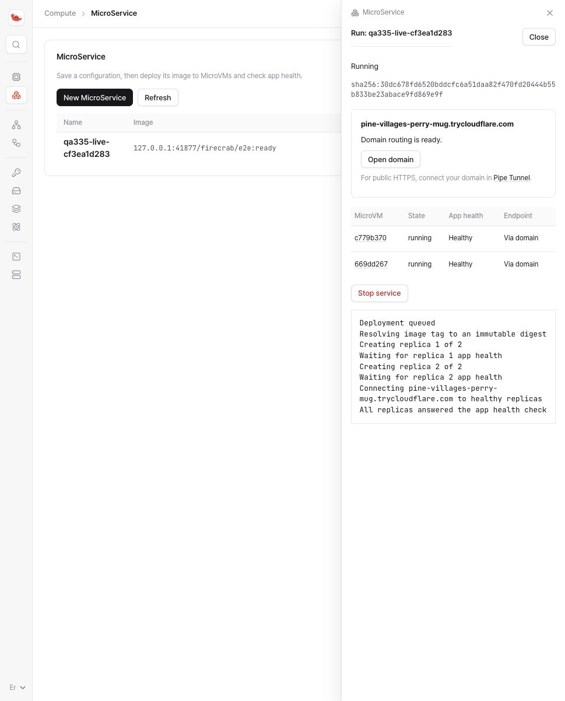
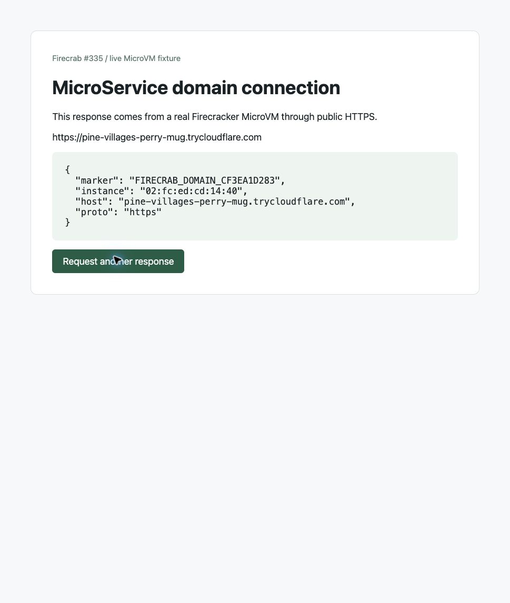

# MicroService domain live QA

Run this test on a dedicated Linux/KVM host with an empty Firecrab API and Pipe
configuration. The API and privileged helper must use the same private installation
paths. Install the bundled ingress engine, the pinned cloudflared engine, and the
normal OCI import prerequisites. The test uses the local OCI fixture; it does not
pull an application image from Docker Hub.

```sh
sudo python3 scripts/test-microservice-domain-live.py \
  --api http://127.0.0.1:15335 \
  --restart-unit firecrab-qa335-api.service \
  --output /opt/firecrab-qa335/live-report.json
```

The runner accepts only a loopback API and a `firecrab-qa335-` restart unit. It
requires an empty API and absent Pipe configuration before creating resources.
It starts ingress on `127.0.0.1:18335`, obtains a temporary Quick Tunnel URL, and
uses that hostname as the MicroService domain. The HTTP fixture exposes a health
marker and its VM MAC address. HTTPS certificate verification stays enabled.

The runner deletes its connector before stopping the service, then removes its
VMs, services, routes and MicroNetworks. Its `finally` block also attempts cleanup
on failure. The operator must stop the dedicated API/helper and ingress units
and remove the disposable installation after saving the report. Inspect any
`cleanupErrors` before removing the installation.

For an independent external client check, add `--external-ack PATH`. After the
report reaches `awaiting_external_probe`, request its `publicUrl` from another
machine with certificate verification enabled. Check `/cgi-bin/identity` against
the report's marker and hostname. Write a JSON acknowledgment to `PATH` with the
matching `marker` and `publicUrl`, plus the observed HTTP status and TLS evidence.
The runner waits up to 180 seconds for that acknowledgment.

Add `--capture-ack PATH` to pause after public requests reach both healthy VMs.
Capture the real dashboard and open its **Open domain** link in a browser. The
fixture page shows the serving VM identity from a live HTTP request. Save the
images, then write a JSON acknowledgment with the matching `marker`, `publicUrl`
and a nonempty `screenshots` list. The runner waits up to 600 seconds before
continuing the API-restart and VM-failure checks.

## Measured result: 2026-10-23 KST

Source: `SteelCrab/firecrab`, branch `feat/335-microservice-domain`, uncommitted
feature snapshot after base commit `194a26daa6af9869215896d223399ba563a6a14b`.
The source file hashes and installed binary hashes were recorded with the logs.
This is a source QA result, not a released-build or named-tunnel DNS claim.

Host: MSI Linux x86_64, Ubuntu 26.04.1 LTS, native KVM, Firecracker 1.17.0.
The API, helper and CLI used native debug builds. Ingress used the bundled static
Nginx 1.30.6 engine. The connector used pinned cloudflared 2026.10.0.

| Check | Result |
| --- | --- |
| Deploy two real MicroVM replicas using `{}` | PASS; automatic network, healthy replicas, no host forwards |
| Public HTTPS health request | PASS; trusted certificate, TLS 1.3, HTTP 200 |
| Twenty public identity requests | PASS; both VM MAC addresses observed; original Host and `https` scheme preserved |
| Stop and restart the dedicated API | PASS; five HTTPS requests succeed while API is stopped; ingress, connector and both VM PIDs stay unchanged; service is re-adopted |
| Deploy an app with a failing health path | PASS; failed VM removed, no owned domain route, healthy public service unaffected |
| Stop one serving MicroVM | PASS; eight public requests reach the surviving VM |
| Independent macOS client | PASS; system curl verifies the certificate (`ssl_verify_result: 0`), HTTP 200, expected marker, Host and HTTPS scheme |
| Resource cleanup | PASS; zero VMs, services, MicroNetworks, routes and Quick Tunnels; QA API/helper/ingress stopped; QA unit files and installation removed |

The temporary public URL was retired after the checks. No long-lived public
endpoint or named-tunnel DNS record was created. Local evidence files are
`live-report.json`, `live.log`, `runtime.log`, `source-manifest.json`,
`environment.txt` and `cleanup.log` in the retained validation output directory.


## Real browser capture: 2026-10-23 KST

Repeated on native KVM after synchronizing main. API, CLI and helper sources were
at `1f2816f26ea67f3173991acda2822a62df7645a4`. The QA runner added a browser-capture
pause and a small HTTP fixture page. The dashboard included a narrow runtime-table
CSS correction: list column widths no longer apply to the replica table.
All replica header and value bounds were checked in the real browser.

Nine live checks passed. Chrome used the real MSI API and public HTTPS; no API
responses were intercepted. The two public screenshots show different VM MAC
addresses under the same hostname and marker. They were captured before the
failure checks and resource cleanup.





Additional screenshots:

- [Public response from the other VM](../../assets/dashboard/microservice-domain/public-vm-a.jpg)
- [Automatically managed route and both guest app addresses](../../assets/dashboard/microservice-domain/pipe-route.jpg)
- [Empty service list after cleanup](../../assets/dashboard/microservice-domain/dashboard-cleaned.jpg)

[Machine-readable results and screenshot hashes](../../assets/qa/microservice-domain-20261023.json)
record all nine checks and the final cleanup state. VMs, services, MicroNetworks,
routes and Quick Tunnels were empty. The dedicated API/helper/ingress units were
stopped and removed. Ports 15335/18335 were closed, the QA installation was removed,
and the local SSH forward was closed. Unrelated QA processes were left running.
