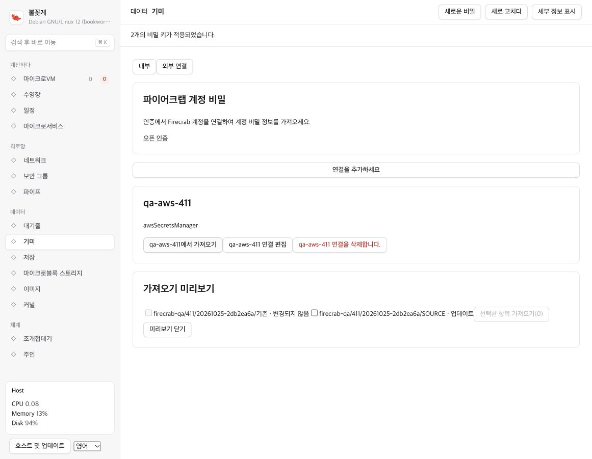
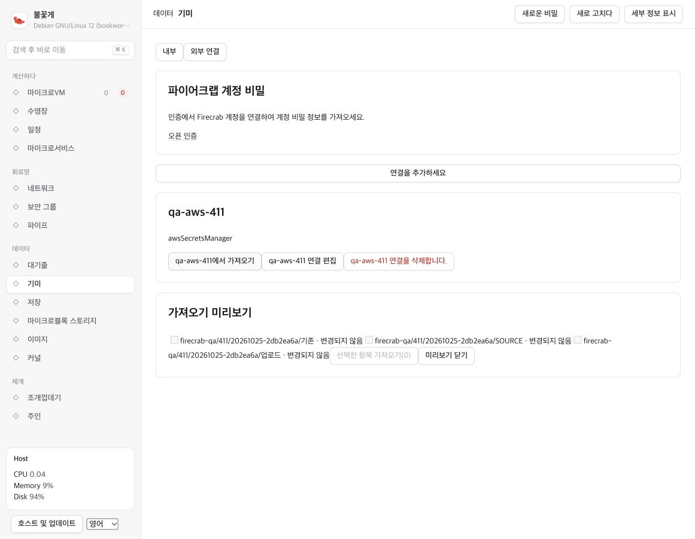

# PipeSecrets provider QA

## Recorded run: 2026-10-25

The run used `origin/main` at `ad89bf18` with the AWS prefix validation fix
in `b6056419`. Two disposable Linux API processes and a freshly built Rust/WASM
dashboard ran in a separate Docker network. The installed microManager API and
its database were not changed.

| Provider | Result | Evidence |
| --- | --- | --- |
| AWS Secrets Manager, `ap-northeast-2` | Passed | Actual AWS account, browser actions, API checks, and AWS CLI verification |
| Another Firecrab instance | Passed | Actual HTTP import and selected upload between two Linux API processes |
| Infisical account | Pending | No real-account connection details were available; protocol fixture tests passed |

The combined provider-connection item in issue #411 remains unchecked until
the real Infisical account check passes.

## AWS checks

All AWS values used a unique `firecrab-qa/411/` name prefix and synthetic values.
Existing account secrets were not changed.

1. Register the AWS connection in an empty QA API. Reject `!prod/` with HTTP 400.
2. Preview actual AWS values. New entries are selected; replacements are not.
3. Explicitly select a replacement and import both entries through the browser.
4. Compare imported values without printing them. Check source metadata, stable
   UUIDs, and the replacement's version increment.
5. Rotate only the remote QA value. The local copy must remain unchanged.
6. Preview again, select the replacement, and verify its value and version.
7. Upload one selected local entry. Read it back through AWS and confirm the
   unselected local entry was not created remotely.
8. Restart the disposable APIs. The saved AWS credential still works; all three
   remote entries preview as unchanged and local entries are not duplicated.
9. Check that public metadata and vault bytes contain no plaintext values or
   AWS credentials. Remove the connection and confirm local copies remain.

All nine checks passed. The three AWS QA secrets were scheduled for deletion
with a seven-day recovery window. The saved AWS connection was removed.

The eight provider regression tests, strict API Clippy (all targets), formatting,
and the WASM production build passed. The Infisical fixtures are not a substitute
for real-account verification.

## Screenshots

Chrome auto-translation was active in these captures. They verify transfer state,
not the dashboard's Korean localization. Values and credentials are not shown.

