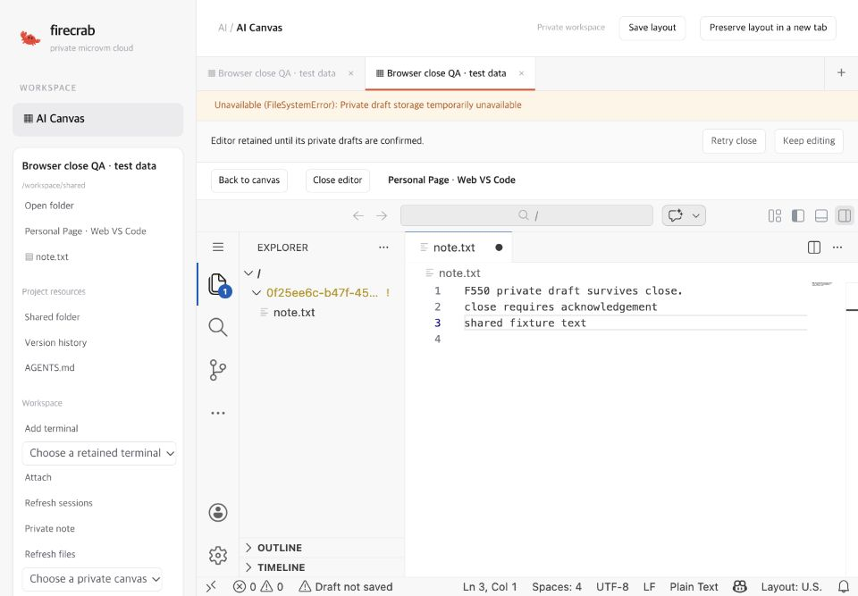
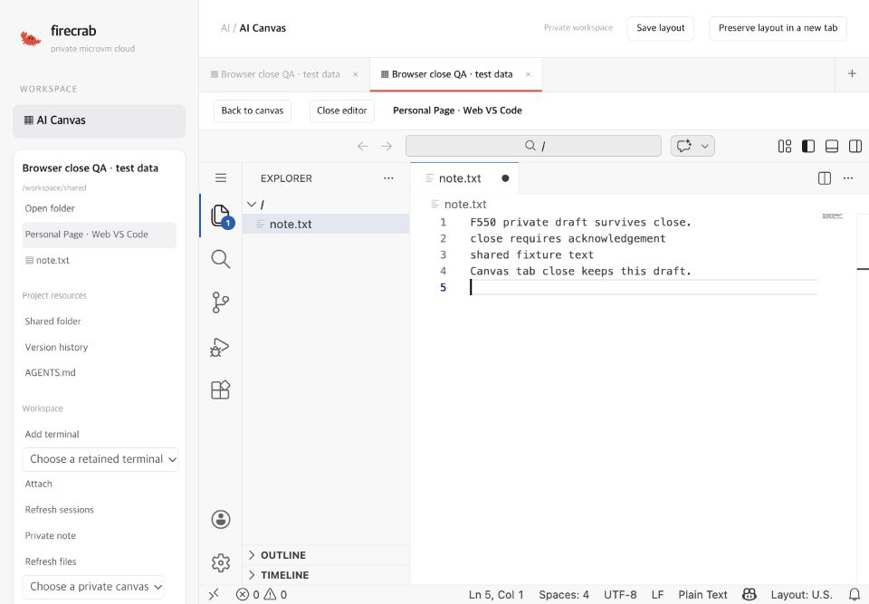

# Editor browser close validation — 2026-11-01

Related: #550 and Draft PR #562. Keep the PR unmerged. This record covers explicit editor/Canvas-tab close, private recovery copies, and window identity. It does not complete the issue's live workload acceptance.

## Implemented behavior

Schema 7 adds retained private browser controls and immutable close copies. The browser freezes its own iframe, the web extension flushes accepted private drafts, and SQLite verifies their exact revisions/hashes before acknowledging detachment. Cancellation waits for the same window to resume. Native process termination is separate. Copying an iframe URL cannot substitute its other workbench document's acknowledgement. Workbench configuration uses JSON defaults and a nonce-preserving trusted bridge.

The worker defers opening its own virtual filesystem until activation returns. Real editor testing exposed and fixed the activation/filesystem deadlock during retained-draft restoration. Manual saving is the editor default so private draft persistence does not automatically change the shared project file; explicit user auto-save preferences remain supported.

## Local automated checks

```sh
CARGO_INCREMENTAL=0 cargo test -p firecrab-api project_workspace --locked
CARGO_INCREMENTAL=0 cargo clippy -p firecrab-api -p firecrab-api-types --all-targets --locked -- -D warnings
cargo fmt --all -- --check
node --test firecrab-frontend/tests/editor-bundle.test.mjs firecrab-frontend/tests/editor-client.test.mjs firecrab-frontend/tests/canvas-panes.test.mjs
cargo test --manifest-path firecrab-frontend/Cargo.toml --locked
(cd firecrab-frontend && CARGO_INCREMENTAL=0 npm run lint)
(cd firecrab-frontend && CARGO_INCREMENTAL=0 npm run build)
python3 scripts/check-doc-links.py
```

Results: **66 project-workspace API tests, 23 Node tests, and 205 frontend Rust tests pass**. API/types clippy, frontend WASM lint/build, formatting, and documentation links pass. DB tests exercise durable exact-byte copies after a newer draft and DB reopen, stable/reordered acknowledgements, cancellation, stopped-runtime access, two document proofs, ownership, grants, quota preservation, and additive schema migration. The Node harness rejects opening our virtual files before activation returns. It also exercises in-flight saves, mutations during flush, lost acknowledgements, read-only closing, unsupported dirty documents, newer-window conflict preservation, and source/origin/challenge fencing.

Four additional hosted browser-controller regressions are authored in `firecrab-frontend/tests/canvas.test.mjs`. They use a clearly labelled HTML stub and a stateful controller, not a VM or native IDE. They cover acknowledgement-before-disposal, cancellation/resume, accepted ambiguous replies, and unaccepted request retry identities. Local browser control uses CUA only; these hosted regressions await the head CI result.

## Real editor UI evidence

The UI exercise uses the compiled Canvas frontend and the actual pinned official **OpenVSCode Server 1.109.5 Linux ARM64** archive, SHA-256 `36d9c14036489b63de84ebace837fcacf7e60e669a0dc715802c5443684ea4dc`. Its native process runs as **UID/GID 100000** inside a separately owned, loopback-only Docker QA container. The final worker bundle is `2b0fd7606955c4d648d6d98855b40f7b4c89ff135805a4b0df5a752c6839589b`. Its controller/file API is a stateful synthetic fixture with disposable text. No provider account, real project files, or installed service is used.

CUA drives the real browser/IDE. The dedicated QA workbench uses official `editor.editContext: false` to expose Monaco's textarea because the automation interface cannot type into native EditContext. This is QA configuration, not a product or personal browser setting. The final workbench also uses the product's manual-save default.

Verified UI sequence:

1. Type into a real virtual project file without a shared-file save.
2. Reject private draft writes. Explicit close retains the same frozen iframe and offers Retry close / Keep editing.
3. Keep editing. Resume acknowledgement restores input and preserves its text.
4. Restore private writes and lose one accepted control reply. Retry reconciles the accepted close without duplicating the native process.
5. Dispose the editor only after a confirmed immutable copy. Reopen the original Canvas and recover its private text/open file.
6. Close a Canvas tab after another edit, open its saved Canvas, and recover that edit. Keep the native server alive across close/reopen.





Final dedicated-controller metrics: **0 shared-file writes**, shared saved version **1**, **0 native stop requests**, and **3 accepted close snapshots**. The native container start timestamp remained unchanged across the final close/reopen exercises. A separate never-activated QA client remained opening; it produced no acknowledgement and is not counted as a successful close. QA cleanup removed the owned browser tabs.

These screenshots show actual editor UI with synthetic controller data. They are not the visual mockup and do not establish real SQLite/VM integration. Private DB persistence and authorization are separately tested by the API suite.

## Remaining acceptance

The existing Linux QA environment still returns `/bin/bash: Input/output error`. It was not reset or restarted. Dedicated Docker QA does not qualify MicroVM/KVM stop/start/replacement, the production service UID, actual multi-user authentication, owner handoff, or interrupted volume operations. Native conditional stop/replacement and workload restart/recovery acceptance remain pending.

Forced browser/process shutdown cannot await an asynchronous save. Only acknowledged private data has a durability guarantee. The guide documents the explicit-close path and unload warning. Do not mark forced-shutdown or complete lifecycle acceptance as passed.

Sandbox project-DB migration, provider-backed folder agents, saved-instruction admission, official skill installation, automated matched backups, genuine cross-host restore, and integrated issue acceptance remain open. No merge, auto-merge, release, installed-service restart, or workload VM reset is part of this change.
