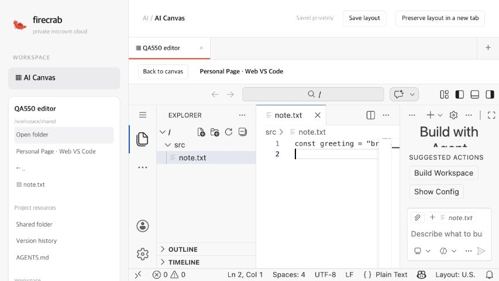
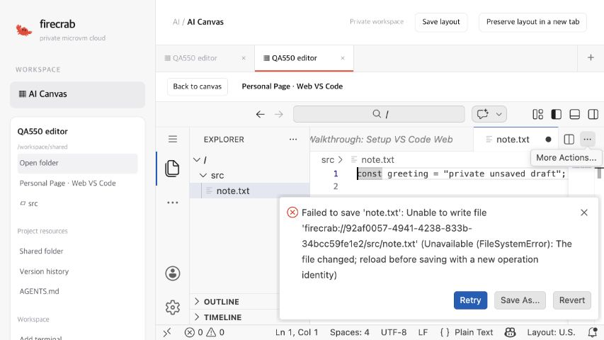
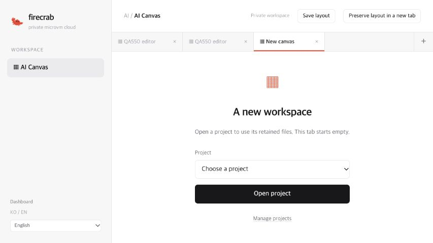

# Project web editor recovery evidence — 2026-11-01

This report covers the real editor implementation slice in #550 / draft PR #562. The screenshots show a running workload VM and authorized project APIs. Full issue acceptance remains incomplete.

## Environment and artifacts

- Owned Linux/KVM fixture: `c1e3b869-9fab-40cc-b98e-b6f34bd34789`.
- Debian 13 arm64 controller, Firecracker 1.17.0, Ubuntu 26.04 v5 guest, 1 GiB guest RAM, retained ext4 project volume.
- Separate controller/editor/writer/viewer certificates with UUID CN and matching host URI SAN; real mutual TLS and project/VM grants.
- OpenVSCode 1.109.5 arm64 archive SHA-256: `36d9c14036489b63de84ebace837fcacf7e60e669a0dc715802c5443684ea4dc`.
- Initial API SHA-256: `610ec93e9b108d7fff85dfc5b15128b0dd94a83a11f3d484d2ee005aacd01b7d`.
- Browser/recovery API SHA-256: `ab54f9bd7ea85b9967337449544913d1335c12637b8b9431f581e30d7607f340` (source snapshot tree `c9859a80be05df97bb7109b4182f9df2e64447d4`).
- Existing installed API PID and workload units were checked before and after both runs and preserved.

The QA transport exposed only loopback HTTP to the browser. It forwarded to the dedicated namespace with certificate verification and the selected test caller certificate. It did not change the installed API, disable TLS verification, expose provider credentials, or bypass a browser security warning.

## Observed behavior

| Check | Result |
| --- | --- |
| Actual retained folder and verified VM binding | PASS |
| Actual OpenVSCode process and workbench HTML | PASS |
| Same view UUID for two callers produces different physical editors | PASS |
| Other callers cannot access an editor host | PASS |
| Editor hosts cannot reach controller/provider APIs | PASS |
| Editor-bound file save appends history; private buffers stay caller-scoped | PASS |
| Explicit reopen after API restart preserves editor identity | PASS |
| Browser opens the real `src/note.txt` and saves shared version 3 | PASS, manual browser QA |
| Editor metadata and private draft remain queryable while VM is stopped | PASS, recovery run |
| Explicit editor reopen after real VM reboot preserves editor identity | PASS, recovery run |
| Saved private canvas reopens through the actual UI | PASS, manual browser QA |
| Private dirty text reappears in the real editor after VM reboot | PASS, manual browser QA |
| Draft base version 2 cannot overwrite shared version 3 | PASS, manual browser QA and API readback |
| Plus button creates an empty tab while existing tabs remain | PASS, manual browser QA |

The original editor harness passed seven backend gates, then reached its browser handoff deadline. Its overall result remains **FAIL (browser handoff timeout)**. It is not reported as a complete successful run.

A separate recovery run completed from `2026-10-31T15:59:29Z` to `2026-10-31T16:11:14Z`, returned zero, and passed both automated recovery gates. The actual resumed binary was verified separately using the browser/recovery checksum above; the inherited bootstrap-checksum field in the recovery harness output was not used as evidence of the resumed API binary.

The original guest boot was `1b9d0fa4-3099-4e4c-b1fc-b4d50b3a8feb`. The resumed guest boot was `5e7afb1b-79b0-4a0f-8db1-8d339d72ff5b`. The retained editor identity was `92af0057-4941-4238-833b-34bcc59fe1e2`.

Browser readback after recovery confirmed the private buffer retained base version 2 and its original text. The shared file retained version 3 and the later text saved from another canvas. The editor showed the restored dirty buffer and a rejected stale save. No overwrite was accepted.

## Screenshots

Actual editor with API-backed file save:

Restored private dirty buffer with an expected stale-save rejection:

Independent empty tab:

## Validation and limits

- `cargo test -p firecrab-api project_workspace --locked --offline`: 46 project-workspace tests pass on the isolated Linux arm64 builder.
- API clippy and frontend WASM clippy/build pass. Frontend native Rust tests pass (204 tests).
- The complete frontend Node/browser command did not pass: its browser suite could not import the missing local Playwright dependency. This is not counted as browser-test success. Browser interaction above was checked against the actual editor separately.
- QA used controller UID 0. Production service UID 995 is not accepted by this report.
- The real editor gate is localhost/glibc only. Remote editor-domain configuration and Alpine editor support are not claimed.
- No live ChatGPT/Claude connection is available. No live model execution, official skill installation, cross-host restore, or unflushed power-loss behavior is accepted by this report.
- These runs do not close #550, mark its remaining checkboxes complete, or authorize merging PR #562.

See [project editor guide](../guides/project-web-editor.md), [file recovery](project-files-recovery-2026-10-31.md), and [terminal recovery](project-terminal-recovery-2026-10-31.md).
