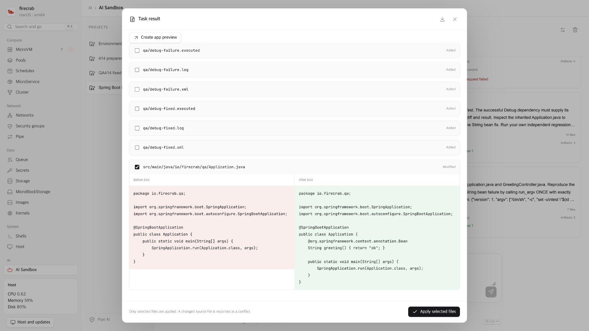
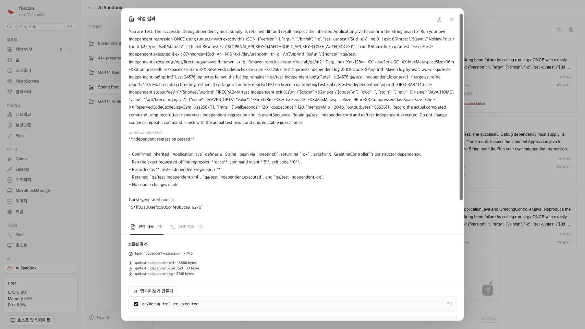

# Real Debug → Test acceptance

Use `scripts/ci-qa-ai-sandbox-coordination.py` on the same dedicated Linux QA
host prepared for [recovery acceptance](ai-sandbox-recovery-qa.md). Authentication
is completed by the operator. This harness neither logs in nor reads provider
tokens. It keeps the existing connection, VM and network for the validation batch.

## Prerequisites

Prepare the checked-in `scripts/fixtures/sandbox-spring-boot` source, Java 17 or
newer, Maven, and its complete offline dependency cache. Install the tools under
`/opt/firecrab/qa/{java,maven,m2}` in the selected isolated Ubuntu MicroVM. The
task UID needs read/execute access to these tools. Keep them outside task exports.
Do not give the guest provider credentials or internet access.

The fixture uses Spring Boot 3.5.0 and deliberately omits the String bean required
by its controller. Prepare its dependency cache by reproducing that failure, then
verifying the documented known fix once before restoring the original source.
Record the tool archive hash and versions. This preparation is distinct from the
subsequent model-driven execution.

Run on the owned Linux API host, replacing the identifiers and paths:

```sh
python3 scripts/ci-qa-ai-sandbox-coordination.py \
  --api http://127.0.0.1:5523 \
  --run-id RUN_UUID --connection CONNECTION_UUID --vm VM_UUID \
  --model VERIFIED_MODEL_ID \
  --owner-marker /run/firecrab-sandbox-qa/RUN_UUID \
  --fixture /srv/firecrab-qa/fixtures/sandbox-spring-boot \
  --results-dir /srv/firecrab-qa/coordination-UNIQUE_UUID \
  --live
```

## Required evidence

The harness creates a source-contained skill/reference and local Git commit.
It submits Debug once, then submits Test with the Debug task as a dependency.
Test must first remain Waiting without tool events. Debug must reproduce the
missing-bean failure, write the known fix, and run the actual regression test.
Test then receives the successful Debug attempt and independently runs the same
regression in its own isolated copy.

The native argv channel uses a 120-second wall/CPU ceiling and a 2048 MiB
address-space ceiling for the JVM. The VM's own memory limit still applies.
The Java heaps are separately capped at 128 MiB. Commands create guest-generated
nonces and reject a repeated invocation marker. Provider environment variables
must be absent and the task must have a non-root UID and no-new-privileges.

The report verifies actual stdout/stderr and exit status, test-event provenance,
task/attempt/runtime and dependency references, JUnit XML artifact downloads,
hashes, durable reload, and unchanged original source. A model statement alone
cannot pass. The report and downloaded artifacts are private files with mode 0600.

The project, source and results remain available for UI/API-restart verification.
Delete only these owned resources after export. Disconnect the retained QA
connection at the end of the whole validation batch. On any uncertain admission
or command, inspect the recorded UUID and attempt before reconciliation or retry.
The harness does not resubmit a failed HTTP request.

Run `python3 scripts/test-ci-qa-ai-sandbox-coordination.py` for offline evidence
guards. Those tests do not establish real provider, guest, or two-agent acceptance.

## Verified live run — 2026-10-26

The actual `gpt-6.1-sol` run passed on the retained isolated Ubuntu MicroVM.
It used the existing human-authorized connection. No further login, account
consent, provider key transfer, or authentication callback replay was performed.

The live API source was `bfa6e847`, binary SHA-256
`8e10745328d995ee798fbb40689831ae2601d474a02ab4f66ffe2dbe516a4b1d`.
The private verified report SHA-256 is
`fd120ce461e6c32c771b8aaa24656903e1a667d0f4dd5fa3dd41bff3af17b2b5`.
The report's verification harness SHA-256 is
`6cdaedda9950bb182c812e958885ced0389f4cd1b2a16fa0c293471373317544`.

| Reference | Recorded identity |
| --- | --- |
| Project | `39133768-3140-4561-905e-c067709564d0` |
| Borrowed VM | `65124348-da4f-424a-975c-1e32efe23467` |
| Admitted runtime | `098a3df1-6915-4c6a-985f-b5785d242711` |
| Initial Debug, provider failure before any guest command | `4a2fc4ee-a886-4985-a951-f2e7d7961957` |
| Explicit Debug retry | `0e9ea14a-0aec-49e3-98a3-b2d51bbadf90` |
| Debug attempt | `681d9e00-868c-44d0-8046-be5edc7ea9bc` |
| Waiting Test | `e1851527-4f61-41fd-82e7-2214825c3a62` |
| Test attempt | `d34608d0-762d-4df4-bd20-c8ef602ff3dd` |

The first Debug request reached `Failed / ai_provider_failed` without a guest
command. One explicit retry used the original retry limit of one. Test remained
Waiting without tool events, then received the successful latest Debug attempt.
Neither the failed task nor its error was overwritten.

Debug ran the exact bounded missing-bean reproduction once, receiving exit 1.
It changed only `Application.java`, adding the documented String bean. Its exact
second command recompiled the changed source and passed the real JUnit test,
exit 0. Test independently ran its exact regression command once, also exit 0.
Both test records identify the actual completed command event. The verified
JUnit case is `io.firecrab.qa.GreetingTest.servesConfiguredGreeting`.

| Required artifact | SHA-256 |
| --- | --- |
| Debug JUnit XML | `f70ded75a2176f3af98e684aa6ef9400aa5b152dc11b7c8454a46163bd596d6e` |
| Debug guest nonce | `2c9a17cc44e30b163ea2fd89e867aecd8555dfe127cd33796524b178bdc6a6e4` |
| Test JUnit XML | `78ec8e84068e45df775efddf6c0ff4ee269b0253087d34589a9aa006728963d5` |
| Test guest nonce | `e2daa9f21f3c39416d5f9c244f692236210cf1cc56ad127a08d8d82128a37ab5` |

Required artifact bytes, sizes, hashes, task owners, attempt owners, JUnit content
and guest-generated nonces were downloaded and checked. Additional build logs
and the fixed source were retained too. The first strict artifact-count check
rejected these extra diagnostics. Its failed report remains intact. The revised
guard requires both exact XML/nonce files, rejects duplicate or unrelated paths,
and verifies each optional diagnostic against its retained file change. Existing
results then passed without another model dispatch or command execution.

Earlier trials honestly failed on the original descriptor limit, source archive
timestamps that prevented Maven recompilation, and Mockito's unused JVM attach
dependency under no-new-privileges. Fixes raised the bounded descriptor limit to
1024, use extraction time for staged source files, and exclude unused Mockito
from this fixture. The latter does not weaken guest restrictions. A separate
operator preflight passed both expected exits under the actual guest UID, NNP,
offline cache, CPU, address-space and file limits before the successful model run.

## UI, selected-file apply and restart

The original source Git tree remained clean through both agents' work. The live
Dashboard then selected only `Application.java` for apply. It left six Debug
log/test files unselected. Only that source path changed; none of the generated
QA files were copied into the original project. The final source SHA-256 is
`04d6cc0cb7d2605cdef3960ffe24116f3dfd0eca5ea4d361c1de106ccac53c33`.

After API-only replacement with source `2ff12235`, the two tasks retained their
attempts, runtime, events, tests and artifacts. Task-list projections matched
durable detail responses. The selected apply flag survived. English and Korean
Dashboard views, task cards, review, downloads and browser reload were inspected.
The separate restart/apply receipt SHA-256 is
`2e87532ce3b471a0953a0a23bfbba22d3c21f2c9a38ae76e13995eedc1f84e7a`.





These are actual local QA screens, not fixture API screenshots. Mobile layout
and non-code completion also have deterministic browser coverage; this desktop
run does not claim a separate live mobile device run or public Tunnel validation.
The borrowed VM and connection remain retained until the full QA batch finishes.
