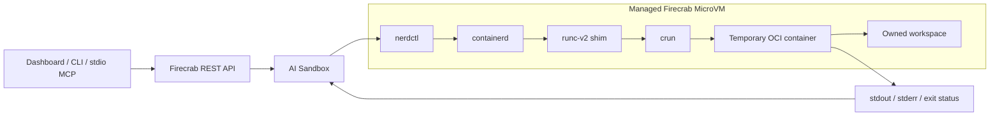

# containerd + crun: real MicroVM benchmark

Use containerd + crun as the recommended OCI execution mode inside managed
Firecrab MicroVMs. This run measured lower daemon memory overhead. It did not
show a command-speed advantage. Existing Workspace and runtime selections remain
explicit.

The [issue discussion](https://github.com/SteelCrab/firecrab/issues/414#issuecomment-6508292014)
includes comparison charts. [Raw observations](sandbox-crun-benchmark-2026-10-30.json)
retain all timing samples and both memory measurement blocks per engine.

## Execution flow

The shim supports a runc-compatible binary. Firecrab explicitly selects the
installed crun path. It does not depend on Kubernetes CRI defaults or start a
Docker daemon for crun execution. Each command creates a temporary container;
this does not provide a persistent container per agent.

## Results

| Metric | Docker | containerd + crun |
| --- | ---: | ---: |
| Command execution median | 113.5 ms | 133.0 ms |
| Command execution range | 67–1,574 ms | 107–223 ms |
| Idle daemon PSS, average | 148.3 MiB | 62.0 MiB |
| Idle whole-VM used memory, average | 262.2 MiB | 227.4 MiB |
| Whole-VM used memory, observed workload peak | 331.2 MiB | 298.0 MiB |
| Workload anonymous memory, observed peak | 67.2 MiB | 67.2 MiB |

Daemon PSS was about 58% lower and idle whole-VM used memory was about 13% lower
with crun. Command execution median was about 17% longer with crun. The Docker
1,574.481 ms sample remains in the data. Ten timing samples on one VM are not a
general workload or throughput benchmark.

## Conditions and method

- Date: 2026-10-30, Asia/Seoul.
- Actual Firecrab-created Firecracker MicroVM, Ubuntu 26.04 ARM64, one vCPU,
  1,024 MiB configured RAM, 4 GiB disk, kernel `7.0.0-29-generic`.
- VM: `7eac7e3e-8dc7-4f32-8a81-a7700c765815`.
- Runtime: `0130ce97-6294-452c-943a-d9af8bb5f877`. Its Firecracker machine config
  confirmed `vcpu_count: 1` and `mem_size_mib: 1024`.
- Docker 29.1.3, containerd 2.2.2, crun 1.21, nerdctl 2.4.1.
- Same OCI index in both image stores:
  `docker.io/library/python@sha256:b658b05ce9c4eb97ec6fc19424818a1f31993659c2b505a532f470e83807815d`.
- Docker overlay2 and containerd overlayfs on the same ext4 guest disk.
- Containers used one CPU, a 256 MiB memory limit, 128 PIDs, an unprivileged UID,
  dropped capabilities, no-new-privileges, guest host networking, and the same
  owned workspace bind. CPU time and file-descriptor limits matched.
- Only the measured engine ran during each block. Order: Docker, crun, crun,
  Docker. Each block used two warm-up commands, then five measured commands.
- Timing covered the local CLI create/run/remove cycle for `/bin/sh -c true`.
  It excluded image download, SSH transport, MicroVM boot and model inference.
- Memory workload: Python allocated a 64 MiB bytearray and held it for three
  seconds. Memory was sampled every 20 ms. Idle values average two blocks per
  engine; reported workload peaks are maxima across those blocks.
- Daemon PSS sums `smaps_rollup` proportional memory for engine-unit processes.
  Whole-VM used memory is `MemTotal − MemAvailable`. It is not host-side VMM RSS.
- Benchmark-only VM and network were deleted. Existing 13 VMs were preserved.

## Runtime compatibility observation

nerdctl 2.4.1 listed the installed OCI index and ran it successfully, but its
Docker-compatible `image inspect` reported `no such image`. Native inspection
returned the expected target digest. Firecrab therefore checks crun image
presence with `image inspect --mode=native`.

The runtime adapter also passed real command execution, workspace file creation,
cancellation and owned cleanup in a disposable Linux environment. That check
used containerd 1.6, nerdctl 1.7.7 and crun 1.8. The MicroVM benchmark exercised
engine commands directly; it did not deploy this API branch or execute a new
model-driven Sandbox task.
