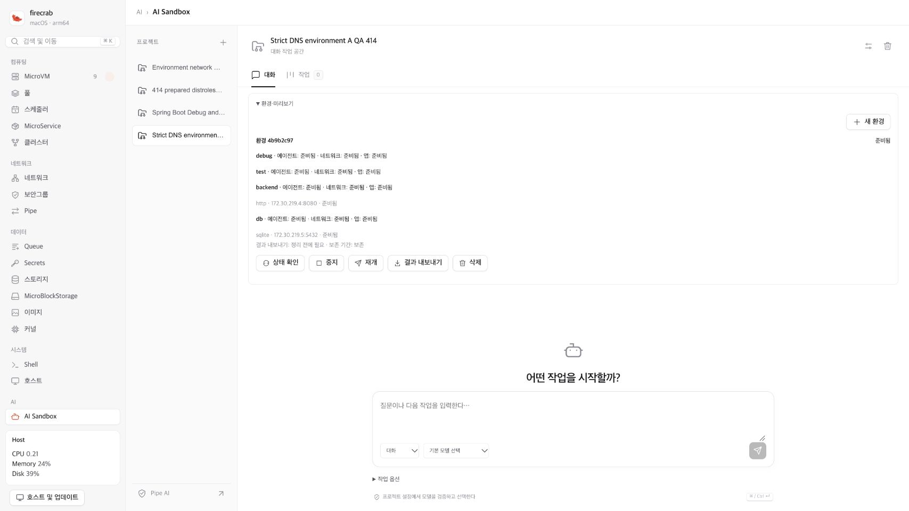
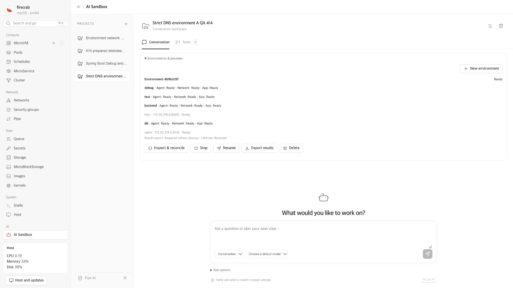

# Sandbox integration QA — 2026-10-27

Implementation and direct QA remain in progress for #414 and Draft PR #520.
Canvas #496 waits for complete AI Sandbox implementation and direct QA
acceptance. Existing shared contracts do not authorize Canvas implementation.

## Source and validation boundary

The earlier actual runs below use Linux candidate `027cccc2`. API SHA-256 is
`6d149ba24e5b6de500b52b84105e2bcc6e520afc66457842cd9352c0e32d4812`.
Helper SHA-256 is
`8c4f1fbfc793b25889f5cfa2d814f70ff911fc2d188d781b594c33f19d527750`.
CLI SHA-256 is
`3a41daac99e7cb2ef07799ebedc702010458e2ac6235eb9f6b0e1697f1ac1afd`.

The later `eb0b50e2` merge includes main `e89d78b4` and its MicroService Deploy
queue. Sandbox, VM, network and helper execution paths are unchanged from the
live candidate. These live results are attributed to `027cccc2`, not represented
as execution of a different binary.

- Ordinary Linux API suite: **1,481 passed**, 18 ignored.
- Exact-candidate privileged guest contracts: **5 passed** with normal parallel
  execution. Prepared BusyBox process checks: **15 passed**.
- These process fixtures use disposable Linux containers. They are not MicroVM
  evidence and did not produce local coverage profiles.
- Frontend: 43 native tests and release WASM build passed. Actual Pipe AI reload
  verifies the restored account layout and ChatGPT icon.

The full API fixture requires a writable checkout, sufficient disk capacity and
an init process that reaps fakeroot's daemon children. Earlier read-only,
small-tmpfs and non-reaping container attempts retain their failures separately.
The complete successful run uses UID 1001, normal disposable overlay storage,
the required tools and Docker `--init`. Test assertions were retained.

CI at `eb0b50e2` passes Rust, rustdoc and the Release Build. That macOS hosted
runner did not acquire capacity and was cancelled before code execution.
Its changed-line coverage was **67.98%** against the unchanged **80%** target.
At `682ee479`, Rust CI passes. The official native coverage artifact hits
**6,068/6,986** added executable Rust lines (**86.86%**). This is the native
LCOV intersection, not the final merged Codecov result. Artifact `12669761490`
is 1,029,412 bytes with ZIP SHA-256
`de6202568229895b10adee0cb28a84492bc47c03d6abe19b2d6586428a23d967`.
Final merged Codecov patch coverage is **86.80%**, above the unchanged **80%**
target. CI run `40361397156` now has **18 successful jobs and one configured
skip**. Its single targeted Installer retry `121840115768` passes after the
upstream stable-kernel metadata becomes consistent. Release Build
`40361397132` has **25 successful jobs and one configured publication skip**.
These results apply to `682ee479`; the later private-DNS repair requires its
own exact-head CI run.
Follow-up Linux
Environment tests pass **15/15** and HTTP permission/lifecycle tests pass **6/6**.
They exercise exact resource reuse, retained Workspace deletion authority,
cleanup checkpoints across DB reopening, service-discovery scope and failed
readiness dependencies. Tunnel lifecycle tests pass **28/28**, CLI Sandbox tests
pass **25/25**, and MCP tests pass **17/17**. CLI/MCP groups overlap and must not
be summed as distinct tests. API/CLI test clippy passes with warnings denied;
format, documentation links and diff checks pass.

An early integration invocation selected two nonexistent Rust module filters and
ran zero tests. Those results do not count as validation. The corrected
`handlers::sandbox_tunnels::tests` and `mcp::tests` invocations produce the actual
28-test and 17-test results above. A separate image preflight lacked rustfmt;
formatting was checked with the installed native toolchain instead.

### Exact integrated Rust validation

A separate disposable Linux run verifies the exact integrated source
`8694175f318a1287ed276cfe06d94e803948a462`, with tree
`aad5d856002c28dc14dea8c97ddb163d0ab85579`. The source remains unchanged and
clean throughout validation. Rust 1.97.1 runs offline with no container network,
CPU 2, RAM 4 GiB, one Cargo job, debug information disabled and incremental
compilation disabled. This is local integration validation, not a new CI verdict
or execution of this source on the QA manager.

| API Tunnel | Helper Pipe | CLI Pipe | CLI Sandbox | MCP | Frontend library | Total |
| --- | --- | --- | --- | --- | --- | --- |
| 39 | 7 | 31 | 14 | 18 | 49 | **158** |

API/helper/CLI test Clippy and standard frontend library Clippy pass with
warnings denied. Unrelated frontend test-lint debt is not changed.

The ordinary API suite records **1,539 passed, 2 failed and 18 ignored**.
`read_uplink_resolves_a_real_default_route_interface` requires an IPv4 default
route that the network-disabled container does not have.
`extract_lifts_the_usr_bin_fastfetch_member` inherits the private-log umask
`077`, which removes group/other executable bits. The same test binary passes
that one test with the standard umask `022`; this separate focused pass does not
turn the full run into a full-suite pass. The earlier attempt with filesystem
tools missing from PATH also remains recorded as **1,329 passed, 212 failed and
18 ignored**. Only PATH is corrected for the later full run; assertions and
source are unchanged.

The private validation receipt is
`/private/tmp/firecrab-414-integrated-8694175f/validation.json`, SHA-256
`7c1300c0ceeaf893cd2dae53d68cc2245cd9e8bafd57d7e072d19014e672370e`.
It preserves the exact source/archive/toolchain/image hashes and all logs.
The earlier `682ee479` CI and coverage results remain attributed to that head.
Exact integrated-head CI remains a separate gate.

## Corrected defects

- Git 2.55 asynchronous maintenance created an advisory `objects/maintenance.lock`.
  Fixtures disable asynchronous maintenance. Snapshots ignore only a regular
  advisory lock without reading or copying it. Links, directories and unknown
  object entries remain rejected.
- Parallel attempts selected the same free GID. A bounded guest-global account
  lock now protects allocation, durable acknowledgement and cleanup. Payloads
  do not inherit its descriptor. Parallel creation and mixed cleanup pass.
- Legacy implicit-network migration used seven SQL parameters for eight
  placeholders. Migration now preserves `legacy_forward` explicitly.
- VM fixtures now persist their network membership. Production missing-network
  checks remain enforced.
- CLI/MCP artifact download now rejects a response for another task before any
  byte request. Metadata and the URL remain bound to the requested task UUID.
  Regression cases cover internally consistent foreign-task responses and
  foreign artifact owners. A distinct binary sentinel verifies that existing
  output content survives a refused overwrite.
- The offline OpenRC evidence checker now rejects root/missing GIDs and unequal
  real/effective user or group IDs. Its seven offline tests do not execute the
  guest payload or prove live guest acceptance.
- The old installed QA CLI lacked Pipe. A matching Linux CLI and verified
  ingress/cloudflared repair HTTP 503 to HTTP 200. See the
  [Pipe recovery record](sandbox-pipe-installation-preflight.md).

## Guarded deployment and capacity

Before replacing binaries, all five existing VMs were stopped and seven retained
tasks had no active or interrupted work. Full task pagination, executable
destination/hash checks and private backups protected the transition.

The initial post-start helper identity check failed. Root preserved that receipt,
verified the stable exact helper executable and private-DNS protocol-3 response,
then resumed API startup and compared all original references. No automatic
rollback or credential-store copy was used. All original connection IDs, task
event counts, Environment generations, VM/network/security-group IDs survived.

The QA system disk filled during staging. Only hash-verified duplicated public
QA executables and failed transfer fragments were removed. Binary staging moved
to the data disk. The same manager's data disk then grew from 16 to 24 GiB through
the official resource controller. After reboot, exact binary identities,
private-DNS support and all original metadata were verified again. The original
deployment receipt remains intact; a separate verification links its byte hash.

## Environment A: actual provisioning and controller restart

| Reference | Value |
| --- | --- |
| Project | `70b3dc57-c6e6-4033-8409-d00d7b406d30` |
| Environment | `4b9b2c97-bff6-4623-aa30-df7e9812c141` |
| Generation | `584299e1-aaf3-451b-aa0a-596575d7c02d` |
| Network | `13d96621-c6b9-4a31-8740-1d595aa330c0` |
| Subnet | `172.30.219.0/24`, private DNS, Internet disabled |
| Roles | Debug, Test, Backend and DB; each 1 CPU, 256 MiB RAM, 1 GiB disk |
| Retention | Persistent Workspace, no TTL |

The operator sent one project PUT, one Environment PUT, one API SIGKILL and one
explicit reconcile POST. API PID changed from 566 to 5008. Helper PID 533 remained
unchanged. A pidfd pinned the exact verified API process.

All four VM directories already existed immediately before and after the signal.
This does **not** demonstrate a crash with fewer than four allocated directories.
The interrupted environment had not completed readiness.

The first reconcile observation contained a transient DB agent-capability probe
failure while the Environment remained `provisioning`. The conservative harness
stopped and preserved that failure. Normal maintenance later reached `ready`.
An independent **GET-only** completion check verified every readiness layer,
the original generation and reserved IDs, exact expected resource additions,
unchanged old metadata and no duplicates. It sent no extra PUT, POST or signal.
The original harness is still recorded as incomplete; the later verifier is a
separate receipt.

All four guests have actual PID 1 `/sbin/init` and successful OpenRC service
status. Authenticated V1 capabilities report `init=openrc`, execution supported,
and Docker/nspawn unavailable. This capability inspection alone does not prove
OpenRC task payloads, limits or cancellation. The later literal task and its
separate cleanup reconciliation are recorded below.

Direct UI inspection selects the actual A project and expands its environment.
Debug, Test, Backend and DB each show ready agent/network/application status.
Backend HTTP `172.30.219.4:8080`, DB fixture `172.30.219.5:5432`, export-before-
cleanup and retained-lifetime labels are visible in Korean and English. A page
reload retains the project URL and language, then fetches the same ready
environment. No reconcile, stop, resume, export, delete or model operation was
sent during this inspection. Mobile acceptance remains open.

## Environment A: read-only network and seed checks

Actual checks: **237 passed**.

| Category | Evidence |
| --- | --- |
| TCP | 23: six live-listener controls, 13 same-Environment IPv4 checks, four IPv6 checks |
| IPv4 | Three allowed paths, six role-denied paths and four denied Internet paths |
| IPv6 | DB self-SSH positive control and three denied peer connections |
| DNS | 210: 192 external queries with no answers, eight own-DHCP resolutions, eight blocked legacy-gateway attempts and two legacy resolver controls |
| Seed | Four actual role reads match the same initial seed SHA |

The seed is a SQLite JSON/TCP fixture on port 5432, not PostgreSQL. Its canonical
initial hash is
`cbcf0a2e4d8b712314490ec9d08466f3ef25f2a082907f941de03aac3d4f36b1`.
No fixture writes were performed.

Role/runtime identities and legacy DNS PID 680, private DNS PID 4920, and their
configuration/hosts/lease hashes remained unchanged during these measurements.
The first inspection assumed JSON output from BusyBox `ip`; that fixture failure
is preserved. A read-only `/proc/net/if_inet6` decoder supplied the actual DB
link-local address without changing guest files or network configuration.

The host bridge has IPv6 disabled and no IPv6 DNS listener. At this A-only
checkpoint, host-listener IPv6 DNS bypass, cross-Environment traffic, independent
writes and actual upstream packet counts remain unverified. Later A/B evidence
is recorded separately below. No listener or address was added to fabricate a
control.

## Independent A/B fixture writes

After the fresh read-only matrix `596dcb25-cb3c-4c41-85a0-ca7d6a4bb213` passes,
the separate run `39518d16-3304-431c-a453-a8b7fc7f1be9` completes with phase
`independent_writes_verified`. It sends exactly one A POST and one B POST.
Each request follows its own Debug → Backend TCP 8080 → DB TCP 5432 path.
Before the requests, both fixtures have their initial values. After A's request,
only A changes. After B's request, A remains unchanged and B has a different
value. Root seed and old values remain unchanged.

| Canonical final fixture | SHA-256 |
| --- | --- |
| A | `71f85e35deacbd4afce77d774f3abdfea9f7a9a0e51625c94116a0d55607761d` |
| B | `1bec571bcf84658cbdeef44013ab5fbb27883b029121e0faea82e6e402e37f2c` |

The retained receipt is
`/var/lib/firecrab/qa-artifacts/414-independent-writes/results/39518d16-3304-431c-a453-a8b7fc7f1be9/writes.json`,
SHA-256 `b020917d869f2fffe0bec64ca0270c24605080afc93c99eacbdd059af5a29568`.
This independent-write pass does not replace the earlier failed deployment or
resume-observer receipts in the [private DNS record](sandbox-private-dns-qa-2026-10-27.md).

## API-only update and OpenRC literal cleanup

The API-only update deploys source `52e1f252921feee99be19f46fdd15350988df57e`.
API SHA-256 is `e9e72f4c5c964737efe7388ada99debbb655978f7d89d0c24a811f09758555de`.
API PID is 199899; helper PID remains 138610. All 13 resource references and
all eight actual guest boot IDs remain unchanged. Helper, CLI, manager and VMs
are not restarted. The verification receipt is
`/var/lib/firecrab/qa-artifacts/414-api-only/df746190-5761-40b4-a528-04fc8fc7679a/result/verification.json`,
SHA-256 `906c8791b65f7ca0874170edd6a1871893fe149b4d96abf228c4f7b6ba3c0dd9`.

Actual task `c8fc16f2-ef45-5aa0-b2c6-dea031cc36c7` invokes one native command
through AI, returns actual exit code **7**, and retains an **882-byte** artifact:
`75935e99e9a0428ef3238a3b037edd19ab392ba5ca66ae63ea8d8184ef45d41d`.
The original **Interrupted**, `sandbox_guest_cleanup_required` failure is kept.
One later reconcile POST reaches **Cancelled** without rerunning the command or
model. Events, result, tests and artifacts remain unchanged. The owned account,
group, control state and recorded PID tuple are gone. The separate final verdict
SHA-256 is `830a979accd9adb0d27ffff0756469495ce22cf405584699e8f8398129453084`.
Reconciled Cancelled is not a new successful Result.

The [OpenRC record](sandbox-openrc-v1-qa-2026-10-27.md) separates actual literal
argv/env, NUL stdin, separate streams, exit 7, NoNewPrivs/caps/groups/limits and
cleanup evidence from local regression checks. Memory, wall-time, output-limit
and actual cancellation tasks remain held. A new memory run is rejected by
automatic approval review before CreateProcess because the existing approval
covers only the literal task. Root has requested approval for the four new tasks.

## Remaining gates

- B creation was rejected by automatic approval review before execution. The
  user then explicitly approved the exact B project, Environment and four-role
  VM allocation on this same private QA manager. One-shot creation reached Ready
  after 90.5 seconds. Initial seed and eight guest capabilities pass, but the
  initial A/B verdict fails because A's internal DNS names are unavailable.
  [The actual DNS record](sandbox-private-dns-qa-2026-10-27.md) preserves that
  failure, the guarded maintenance failure and the separate manual disposition.
  The repaired source `34a45b95` passes a fresh running A/B matrix: exact own
  addresses in 32 DNS replies, 96 denied cross-Environment IPv4 connections,
  384 external-name responses without answers, and six IPv6 peer denials with
  two positive controls. DNS names remain shared within the private resolver.
  The separate independent-write run above passes after that fresh matrix.
- Obtain separate approval for OpenRC memory/wall-time/output-limit/cancellation
  tasks. Two new TTL environments also await separate approval and host-capacity
  admission; neither is counted as completed QA.
- Complete the remaining actual results/UI and public preview acceptance.
  [Retained-results follow-up](sandbox-results-ui-qa-2026-10-27.md) verifies
  actual Korean/English responsive screens and three artifact byte/hash checks
  after maintenance. A new non-code conversation and public preview remain open.
- Live Anthropic requires a manually registered workspace API key. Public Tunnel
  checks require the user's registered connection and explicit test domain.
- Keep PR #520 Draft while exact-head CI and direct acceptance remain incomplete. Keep
  Canvas implementation on hold.

Earlier actual evidence is retained in the
[recovery](ai-sandbox-recovery-qa.md),
[coordination](sandbox-coordination-qa.md),
[entrypoint](sandbox-entrypoints-validation.md),
[distroless](sandbox-distroless-validation.md) and
[execution-mode](sandbox-engine-validation-2026-10-26.md) records.
