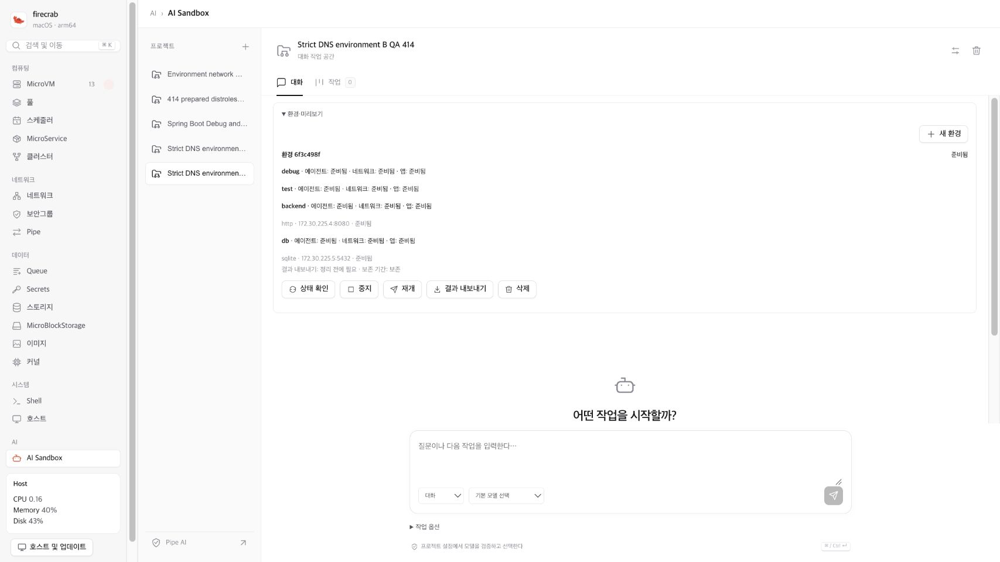

# Sandbox private DNS preservation QA — 2026-10-27

This record covers actual two-Environment QA for #414 and Draft PR #520.
The failed A/B matrix uses API/helper source `027cccc2`. No fixture write or
model task was admitted while the network verdict failed. A later guarded
application of source `34a45b95` reaches an explicit maintenance failure below.

## Approved Environment B

The user explicitly approved this same private QA manager and four-role
allocation. The operator sent exactly one project PUT and one Environment PUT.
Exclusive, fsynced intent and response files were retained. Read-only polling
reached Ready after 90.5 seconds, without another PUT, reconcile or guest repair.

| Reference | Value |
| --- | --- |
| Project | `8ec0a59b-1558-45bb-b7ae-723fe5daa22e` |
| Environment | `6f3c498f-77e1-48b6-adaa-c5bee0a8d6b1` |
| Generation | `e83c2dfb-6603-453b-821d-1c171efa9e03` |
| Network | `883ce38d-6089-431e-9963-33ddae16ad4d` |
| Subnet | `172.30.225.0/24`, private DNS, Internet disabled |
| Roles | Debug, Test, Backend and DB; each 1 CPU, 256 MiB RAM, 1 GiB disk |
| Retention | Persistent Workspace, no TTL |

All four roles reported ready agent/network/application layers. Initial
authenticated capability failures were preserved, then normal maintenance
recovered readiness. The existing A resources, five older stopped VMs, seven
retained tasks/event counts, connection IDs and legacy DNS inputs survived.

## Actual failed network verdict

Eight guests pass PID-1/OpenRC inspection and authenticated V1 capability checks.
Both environments return the same initial canonical SQLite fixture seed:
`cbcf0a2e4d8b712314490ec9d08466f3ef25f2a082907f941de03aac3d4f36b1`.
The fixture on TCP 5432 is not PostgreSQL.

The full observation retains 158 TCP attempts, 472 DNS questions and ten seed
reads. TCP role/cross-Environment policy checks pass. The complete verdict fails:
A's four own `<hostname>.internal` lookups return NXDOMAIN over both UDP and
TCP, while B's eight own-name lookups succeed. The shared private resolver
answers A's requests for B names; B's requests for A names return NXDOMAIN.
The prior A-only inspection passed its eight own-name checks several hours
earlier. There is no fresh successful A lookup immediately before B creation,
so the evidence does not prove that B creation alone caused the failure.

The failed observation SHA-256 is
`c4ce38a7c7a38b38464f87873a2aa609d02c7c0a617d046b4e2bfdea257afe79`.
Legacy DNS PID 680 and private DNS PID 106974, configuration, reservation and
lease file hashes remain stable throughout this measurement. No listener,
address, resolver file, guest package or network rule was changed for the test.

## Read-only diagnosis

The private reservation file contains all eight correct A/B MAC, IP and hostname
entries. They match API allocations and actual guest hostnames. A's four VMs
remain allocated and running. The dynamic DHCP lease file contains only B's four
entries, whose expiries are 21:51:39–21:52:44 UTC on 2026-10-26. At the diagnostic
manager time, 21:03:36 UTC, they have roughly 48–49 minutes remaining.

A's uptime is about 5.2 hours; B's is about 11–12 minutes. A's old expiry cannot
be recovered from the current file. Guest clocks start at the Unix epoch, so
lease expiry comparisons use the manager's UTC clock. The generated bootstrap
uses `udhcpc -i eth0 -n -q -t 8 -T 2`. Process names alone cannot establish whether
a BusyBox applet is still running.

Static tracing shows that complete IPAM reservations are sent to the helper.
VM DNS names depend on dnsmasq's active DHCP leases; only service records are
written as explicit DNS hosts. A private network-set change restarts its DNS
daemon. Lease aging and that restart boundary explain the failure without an
IPAM reservation overwrite, but the historical A expiry is not directly proven.

## Repair and remaining gates

Source `34a45b95` derives a separate private VM DNS hosts file from the
authoritative allocation snapshot. Its records are independent from dynamic
DHCP expiry and service-record refresh. Legacy resolver inputs remain unchanged.
Managed Sandbox manifests and this actual pair use IPv4 allocations; IPv6 bypass
blocking is verified separately. The helper formatter accepts supplied DHCPv6
addresses, but existing reservation sync omits SLAAC addresses. SLAAC AAAA
publication is outside this repair's acceptance and is not proved by a direct
formatter test.

A disposable DNS-only dnsmasq 2.90 fixture reproduces NXDOMAIN before the repair
without a dynamic lease, then passes with the repaired code. Forty DHCP/DNS
tests pass, including short/FQDN UDP/TCP queries, multiple networks, reservation
removal, stale snapshots, resolver restart and service-refresh independence.
The DNS fixture also passes as UID/GID 65534 with NoNewPrivs and no capabilities.
Rust 1.97.1 test Clippy denies warnings; format and diff checks pass.

The final full helper run records 233 passed, one missing-uplink environment
failure and three existing ignored tests. An earlier run also failed a sysfs
first-entry assumption in an unchanged NAT test. The container has no external
network. Tests were not skipped or weakened, and full-suite success is not
claimed. These container checks are not actual post-repair MicroVM evidence.

Three Linux ARM64 candidates are built from the same source. The original API
is 149,363,760 bytes and cannot meet the manager's atomic-install free-space
floor. A separate GNU strip 2.40 transformation removes non-loaded symbol data.
Every allocated ELF section's bytes/attributes, program headers and entry point
match the original. The API candidate is 71,735,768 bytes and meets the budget.
Original binaries and both build/transformation receipts remain intact.

## Guarded maintenance observation

One Environment stop request per A/B pair succeeds. Read-only public resource
checks then confirm all thirteen retained VMs are stopped. The operator applies
the candidate once; there is no automatic rollback or repeated deployment.
Both services start with their exact candidate executable identities:

| Binary | SHA-256 |
| --- | --- |
| API | `ca41a003502aefc2a25f2a87bdbc624de5e061a581585cde08ce2b5a74bffd34` |
| Helper | `08a64cd53e1bea8b0aeb858510efb2f025734a12cfbbf1d22701505fa12d5e22` |
| CLI | `3e37c0429eaeff05456ab84c618ed13df07d65b51ec54f52d64082c8a432633d` |

The helper publishes all eight correct private VM names from IPAM. The private
configuration gains exactly one new hosts-file line; normalized remaining
configuration bytes are unchanged. The post-start guard nevertheless stops at
`action_needed` with `unexpired_dns_lease_removed:dnsmasq-private.leases`.
At the 2026-10-26 21:52:05 UTC observation, dynamic leases for B's Debug and Test
addresses still have approximately 30.5 and 38.5 seconds before expiry. The
Backend lease has approximately 0.5 seconds remaining. All three are missing.
This is an actual failed preservation condition, not a successful deployment
verdict or an expired-row-only change. The original receipt is retained.

## Independent read-only follow-up

The deployed helper unit reports `RuntimeDirectory=firecrab` and
`RuntimeDirectoryPreserve=no`. The recorded helper stop completes at
`inactive/dead` with PID zero. The existing unit policy removes `/run/firecrab`
on stop, including dynamic leases. This boundary explains the missing runtime
rows; it is separate from normal lease expiry or the new explicit DNS hosts.
The failure is retained rather than reclassified as successful lease preservation.

A separate read-only diagnostic confirms unchanged public resource references,
thirteen stopped VMs, the exact three candidate binaries, service/manager
identities and all eight authoritative private names. All **32/32** own-gateway
short-name/FQDN UDP/TCP questions resolve to their expected addresses. A's
sixteen answers succeed without any corresponding dynamic DHCP lease. This is
actual pre-resume proof of the DNS repair, not a completed running A/B matrix.

The diagnostic SHA-256 is
`1d0b87e7979f261e692de25d2cd6f649ba2c5f681868ef252c8cc6d22a3f59da`.
It confirms the original failed deployment receipt is unchanged and never marks
that deployment verified. Independent review accepts a separate manual
maintenance disposition only at this all-stopped boundary. Dynamic DHCP rows,
DNS PIDs and cache preservation are explicitly not claimed across the helper
restart. Manual disposition SHA-256 is
`b8463bbe6b3c8b3a43437d2423ccdfba98baae006af1256c6c75dcba69c0af9e`.

## One-shot resume and fresh read-only baseline

The operator sends one resume POST per Environment. Both return HTTP 200 and
reach Ready with eight new runtime IDs. The five older VMs remain stopped.
No VM, disk, allocation, generation, network, security-group rule, image pin,
project spec, saved connection or retained task is replaced.

The first observer incorrectly requires public host keys to be owned by root.
The actual regular 0644 public files belong to the API service, UID 995 and
GID 989. A later read-only observer also uses a child-local FD path that is
unsuitable for OpenSSH. Both observer failures remain separate receipts; no
resume request is repeated. A narrow, pinned parent-FD channel check succeeds.

The corrected read-only completion captures **eight distinct actual guest boot
IDs**, confirms OpenRC PID 1 and reads the unchanged initial seed **ten times**.
Public resource metadata and service identities stay equal throughout. The
completion SHA-256 is
`88a924a2daeca8f4cd5ea21466aa8ea884e3d2b1e676f249d5d031ae43abed85`.
This is a fresh baseline for the running matrix, not that matrix's verdict.

## Fresh actual running matrix

The separate read-only run `596dcb25-cb3c-4c41-85a0-ca7d6a4bb213` passes at
source `34a45b95`. It freezes the new runtimes and actual boots, the full public
reference snapshot, all five original project specs, network/security-group
rules and original resource identities. Every guest payload has runtime/boot
fences. The full snapshot and stable DNS process/configuration inputs match
before and after the run. Dynamic DHCP observations remain separate.

| Observation | Actual result |
| --- | --- |
| Eight guests | OpenRC PID 1 and authenticated V1 capabilities pass. |
| Initial SQLite fixture | Both deployments keep the same initial seed and empty values. |
| IPv4 role/egress policy | All 122 allowed/denied observations match the manifest. |
| Cross-Environment IPv4 | 96 connections denied; 48 have independently reachable listener controls. |
| Own short/FQDN DNS | All 32 UDP/TCP replies contain the exact expected IPv4 address. |
| Shared private DNS view | All 16 peer-name replies match the peer DB address; DNS-name isolation is not claimed. |
| External names | 384 validated own-gateway DNS responses contain no answer records. |
| Gateway bypass | 32 legacy/other-private-gateway DNS attempts time out, with listener controls. |
| Same-Environment IPv6 | Two DB self-listener controls succeed; six peer connections are denied. |

The DNS parser validates peer, question, ID, compression, truncation and address
RDATA. A header-only or malformed reply cannot pass. The offline parser/scope
suite passes 17 cases. A changed SG rule before collection is rejected against
the frozen full snapshot rather than accepted as a new baseline.

The raw event SHA-256 is
`a861efe2fcf1d96999f281502962bdbd7f7ea4b35153af24196b552284908b93`.
The independent verdict receipt SHA-256 is
`91d8db648fb04c9fc51fb61168c94337aaa9e3e23849ce7beeac47762a86c029`.
Cross-link IPv6 failures are not counted as firewall-drop proof. General SLAAC
AAAA end-to-end behavior and upstream packet counts remain unmeasured. Sixteen
manager-address DNS timeouts have no positive listener control, so they are not
claimed as a separate policy proof. The earlier failed matrix and maintenance
lease-preservation failure remain unchanged.

Keep the failed receipts. Independent fixture writes need a separate one-shot
Root release after this fresh pass. OpenRC model tasks and public preview setup
remain on hold.
Do not remove/recreate environments or manually repair resolver/lease files to
turn this verdict into a pass. Canvas implementation remains on hold.
