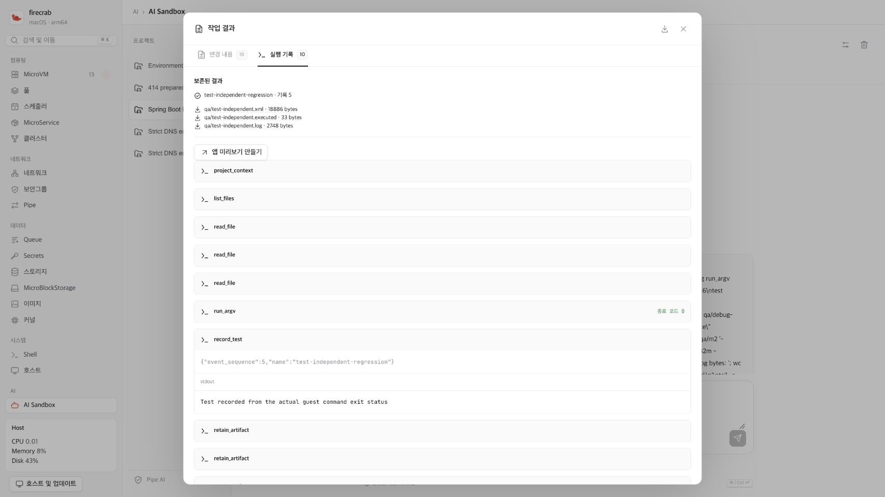
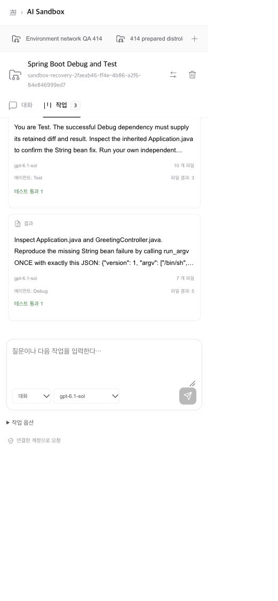
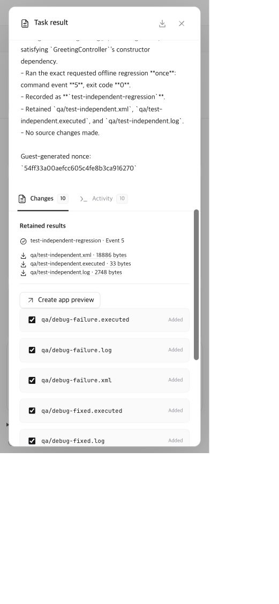

# Retained Sandbox results UI — 2026-10-27

This actual QA uses the existing Spring Boot Debug/Test tasks and the same
private manager. The API and helper run source `34a45b95` after guarded
maintenance. It creates no task, sends no model request and applies no file.
The separate failed DHCP preservation receipt remains unchanged.

## Actual observations

| Surface | Observation |
| --- | --- |
| Korean desktop, CSS 1707 × 960 | Conversation and board retain three code attempts: one provider failure, Debug result and independent Test result. |
| Korean mobile, CSS 391 × 844 | Project selection, board, close/open review and test/artifact indicators work. |
| English mobile, CSS 391 × 844 | The same Test result shows translated review tabs, retained artifacts and selected-file apply controls. |
| Review scrolling | The result, retained artifact list and final apply controls remain reachable. No apply request is sent. |
| Horizontal layout | Document scroll width equals client width at both measured sizes. |
| Restoration | Temporary viewport override is reset and Korean is restored. |

The mobile viewport override initially measured CSS 520 × 1125 despite a
390 × 844 backend request. That intermediate image is not used as 390-pixel
evidence. The final DOM dimensions above are measured directly. These are
responsive desktop-browser checks, not a separate physical mobile device run.

Test task `e1851527-4f61-41fd-82e7-2214825c3a62` retains its original attempt,
runtime, ten events, successful test and three exported artifacts. Each artifact
is downloaded through its task-scoped API after maintenance. All three return
HTTP 200 and match their persisted byte counts and SHA-256 digests:

| Path | Bytes |
| --- | ---: |
| `qa/test-independent.xml` | 18,886 |
| `qa/test-independent.executed` | 33 |
| `qa/test-independent.log` | 2,748 |

The full task response is equal before and after these downloads. The private
artifact receipt SHA-256 is
`cdbb3ac20e12c86e14a5024f727221e632333df86aae20f3e3c27dbb539d20e7`.
No credential store, authentication screen or private process environment is read.

## Remaining acceptance

The prior [coordination run](sandbox-coordination-qa.md) verifies actual Debug
failure/fix, independent regression, selected-file apply and restart retention.
This follow-up adds actual responsive UI and post-maintenance artifact bytes.
It does not verify a new non-code conversation, public preview, Anthropic key,
or the separate running A/B network/data matrix. Canvas remains on hold.
