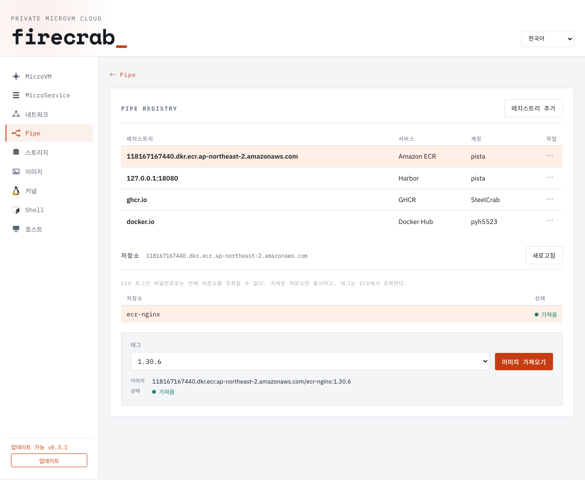
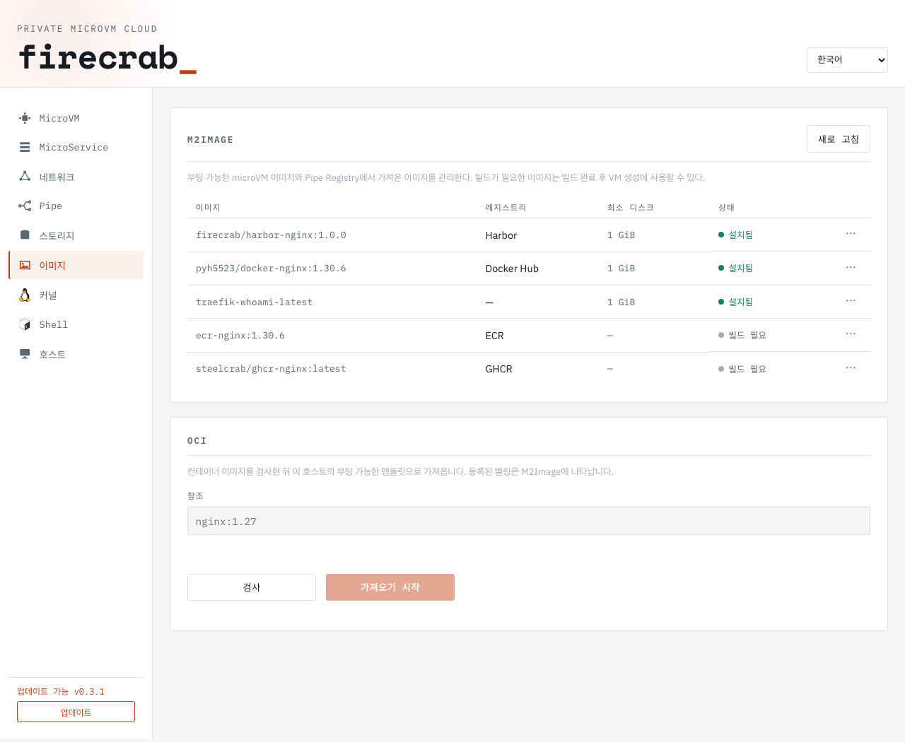

# Pipe Registry

Pipe Registry connects to Docker Hub, GitHub Container Registry (GHCR), Amazon
ECR, and Harbor. It pulls OCI container images to the API host without a Docker
daemon. Image uploads are managed by the source registry.

Connect AWS or GitHub in [Pipe Auth](pipe-auth.md) to share provider credentials.
The connected registry appears automatically. Use **Manage in Pipe Auth** to
rotate or disconnect it. The direct registry login flow below remains available.

1. Select **Add registry** and choose the provider.
   - Docker Hub: enter your username and a personal access token with repository
     read access. This login is shared with the existing Docker Hub settings.
   - GHCR: enter your GitHub username and a personal access token (classic) with
     `read:packages`. Authorize organization SSO if required.
   - Harbor: enter the registry hostname and optional port, a Harbor username or
     robot account, and its password or token. The account must have repository
     listing and pull access. Use the hostname only, without a URL scheme or path.
     Remote Harbor connections require HTTPS. Loopback development registries,
     such as `127.0.0.1:18080`, use HTTP.
   - ECR: enter the login registry URI, such as
     `123456789012.dkr.ecr.ap-northeast-2.amazonaws.com`, and the output of
     `aws ecr get-login-password --region REGION`. Pipe uses username `AWS`.
     Omit `https://`, repository paths, and tags from the login registry URI.
     Tokens expire after 12 hours. Select **Update token** to renew them.
     Optionally enter the AWS account name for the **Account** column. Without
     a name, private ECR connections show the account ID. Authentication always
     uses `AWS`. Get the name with
     `aws account get-account-information --query AccountName --output text`;
     ECR login passwords cannot retrieve account names.
2. Saving a login selects it and loads its repositories. Select another row in
   the registry table to switch registries. The row's **⋯** menu contains
   **Update token** and **Delete**. **Delete** asks for confirmation and keeps
   pulled images. Docker Hub and GHCR use the saved account namespace. Harbor
   lists all repositories that the saved account can access across its projects.
   Docker Hub lists only the saved user’s repositories. A Docker Hub login is
   required. Official images are not used as a fallback.
3. **Repositories** lists the selected registry's repositories. Pipe selects the
   first repository and loads its tags automatically. Select another row to load
   its tags. **More repositories** and **More tags** load further pages.
   **Refresh** reloads the repository list and the local pull status.
4. Select a tag from **Tag** and then **Pull image**. Pulling stays disabled while
   the tag lookup is running or has failed, and while another pull is running.
   Failed lookups can be retried. Repository, tag, and digest text fields are not
   shown. Changing the source registry clears the previous selection. The pull
   panel shows the image, its status, and the job log.
5. The repository **Status** column shows whether a repository has a retained
   image. **Tag** shows tag names only. The selected image's **Status** shows
   whether that tag has been pulled.
   Status is loaded from the host and refreshed after a successful pull, so it
   survives a page reload. This records a previous pull; it does not check
   whether a remote tag has changed since then. **Pull image** remains available
   to update it.
6. Open **Images → M2Image**. Pulled sources appear as **Build required**.
   Use the source row's **⋯ → Build M2Image** to create a bootable template.
   Building uses the retained digest, so a moved source tag cannot change the
   selected image. After success, the installed template replaces the source row
   and becomes selectable when creating a VM. Failed builds retain their log and
   can be retried; page reloads resume a running build's status.

ECR login passwords cannot call the signed AWS `DescribeRepositories` API.
Connect AWS in [Pipe Auth](pipe-auth.md) with `ecr:DescribeRepositories` access
to browse private ECR repositories. Shared AWS authentication issues registry
passwords on demand and supports repository pagination.

With a direct ECR password login, Pipe shows previously pulled repositories for
the selected registry and fetches their tags from ECR. This is not the full AWS
repository list. **Refresh** reloads these records and their pull status.
Without any retained image records, the page says no repositories have been
pulled yet; it does not claim that the remote registry is empty.

Pulls run as background jobs. Pipe polls the status and retains the transfer ID
across browser reloads. Jobs stop if the API process stops; downloaded images
remain on disk. Two pulls may run at once. A retry reuses verified local blobs.
The Registry screen does not show a local OCI image inventory or conversion panel.

A pull retains the selected platform's config and compressed layers. It does not
retain other platforms, signatures, or attestations. These retained images are
separate from M2Image packages and the MicroRegistry catalog.

Credentials are write-only in API responses. They are stored in the owner-only
SQLite database. Removing a login retains downloaded images. Credentials are
scoped to their exact registry, including its port. A custom Harbor hostname must
be registered before Pipe accepts its tag queries or pull requests. Pulls verify
SHA-256 content digests.

## Screenshots

Saved accounts, ECR repositories, and the selected tag's pull status:

Installed M2Images and pulled sources waiting for a build:

## API

| Endpoint | Action |
| --- | --- |
| `GET /api/pipe/registries` | Saved registry hosts, providers, usernames, and optional ECR `accountName`; no secrets |
| `PUT /api/pipe/registries/{registry}` | Save `{username, secret}`; optional ECR `accountName` or `provider: "harbor"` for a custom Harbor host |
| `DELETE /api/pipe/registries/{registry}` | Remove one saved login |
| `GET /api/pipe/registries/{registry}/repositories?page=…` | Repository names, `nextPage`, and `listingSupported`; AWS Pipe Auth also returns `nextCursor`, passed as `cursor` on the next request |
| `GET /api/pipe/registry-tags?reference=…&last=…` | One tag page and optional `nextLast` cursor |
| `POST /api/pipe/registry-transfers` | Start `{action: "pull", reference}`; returns 202 |
| `GET /api/pipe/registry-transfers/{id}` | Transfer status; ID is the POST response's `alias` |
| `GET /api/pipe/registry-images` | Retained OCI metadata and digest-pinned `templateAlias` for M2Image builds |

Harbor discovery uses its `/api/v2.0/repositories` API. Tag lookups and pulls use
its OCI Distribution API and registry token service. Catalog pagination does not
follow provider-supplied URLs with saved credentials.

Run the isolated dashboard tests with `npm run test:pipe --prefix firecrab-e2e`.
They use their own Vite server on port 8096 and API fixtures. Backend tests use
loopback registries and catalog services. Live integration checks require a
running registry and credentials.
