# Architecture

Firecrab manages images, networks, disks, and Firecracker microVMs on one host.
The API owns resource state; a privileged helper performs host operations.

## Components

| Component | Responsibility |
| --- | --- |
| Dashboard and CLI | REST requests and console WebSocket connections |
| `firecrab-api` | Validation, SQLite, image jobs, VM lifecycle, and console broker |
| `firecrab-helper` | Bridges, TAPs, DHCP/DNS, firewall, NAT, VM units, and Linux update application |
| VM shim (`firecrab-api vm-shim`) | One VM's Firecracker process, console, stop requests, and exit record |
| Firecracker | Guest kernel and rootfs on KVM |
| SQLite and filesystem | Resource records and persistent artifacts |
| `firecrab-api-types` / `firecrab-helper-protocol` | Shared REST models / helper protocol v2 |

The API and shim run as the same unprivileged account.
The helper validates the socket peer UID and request fields.
It derives privileged paths and unit settings from trusted host state.

## Host platforms

All platforms run the same Linux services.
The outer runtime and localhost connection differ.

| Host | Runtime | API connection | Diagram |
| --- | --- | --- | --- |
| Linux | Native systemd and KVM | Direct loopback | [Linux](../../assets/architecture/micromanager-linux.en.svg) |
| macOS | Debian 13 ARM64 on `Virtualization.framework` | Key-only SSH tunnel | [macOS](../../assets/architecture/micromanager-macos.en.svg) |
| Windows | Managed `firecrab-debian` on WSL2 | WSL localhost forwarding | [Windows](../../assets/architecture/micromanager-windows.en.svg) |

macOS launchd keeps the VM and SSH tunnel running.
Its OS and persistent data use separate disks.
Windows Task Scheduler runs the native resource controller, which holds WSL open with a windowless `wsl.exe --exec sleep infinity` child; OS and data share `ext4.vhdx`.
The controller serves [management VM resource controls](../guides/micromanager-resources.md) on host loopback port 5524.
Both require nested virtualization.
See the [macOS](../getting-started/macos.md) and [Windows](../getting-started/windows.md) guides for support limits and recovery.

## VM start flow

1. The API records `starting` and continues startup in a background task.
2. It prepares a writable disk generation from the installed image.
3. The helper reconciles the network, attaches a TAP, and applies DHCP/firewall state.
4. The API writes `fc.json` and asks the helper to start a transient VM systemd unit.
5. The unit runs the shim, which starts Firecracker; the API attaches to `shim.sock`.
6. The guest boots and reports `FIRECRAB_NETWORK_READY` after DHCP and DNS checks.
7. The API records `running`.

A host DHCP lease alone does not establish guest readiness.
Failed starts remove processes, TAPs, and policy where possible.
Disk preparation has bounded concurrency; network mutations are serialized.
Every VM requires an explicit MicroNetwork and a registered storage root.
Requests cannot select arbitrary host artifact paths.

## VM lifetime and recovery

Each `firecrab-vm-<id>.service` belongs to systemd, so it survives an API restart or update.
A per-VM `vm.lock` prevents duplicate shims.
The helper accepts only root-owned API and Firecracker binaries that other users cannot modify.
VM units run as the API user and inherit the installed API sandbox and private `/tmp`.
Development API instances have no installed sandbox.

At each VM start, `MemoryMax` is guest RAM plus the larger of 256 MiB and one eighth of guest RAM.
`CPUQuota` is one core per vCPU plus one core.
An external unit stop records a requested stop in `exit.json`.

At API startup, only records left `starting`, `running`, or `stopping` are reconciled.

| Evidence | Result |
| --- | --- |
| Compatible live shim for `running` / `stopping` | Reattach; finish a pending stop |
| Live shim for `starting` | Stop it and record `error` |
| Incompatible or mismatched shim | Stop the unit; record `stopped`, or `error` if stopping fails |
| Clean or requested exit record | Record `stopped` |
| Crash exit record | Record `error` |
| No live shim or exit record | Record `stopped` |

VMs that are not reattached lose their runtime network state after their unit stops.
Untracked VM units are logged and left running for operator inspection.
Network failures on a reattached VM keep it `running` with `networkFailed` diagnostics.
[Network retry](../guides/operations.md#retry-vm-network-recovery) repairs host state without restarting VM processes.

## Persistent and runtime state

| State | Location | After API restart |
| --- | --- | --- |
| VM, network, lease, storage, shell, and forwarding records | SQLite WAL | Reloaded |
| Images and VM disks | Configured filesystem roots | Retained and verified |
| Shim connections | API memory | Reattached |
| Job progress and reconciliation results | API memory | Lost or recomputed |
| Bridges, TAPs, nftables, and dnsmasq | Linux runtime | Reconciled from desired state |

Disk generations survive stop/start; each start gets a new runtime directory.
See [Storage](../guides/storage.md) for paths and backup requirements.

## Images and guest services

Catalog installs, OCI imports, and API-only MicroBoot bootstrap all register image templates.
Only installed templates can create VMs.
Managed kernels have an independent verified cache.
Custom MicroRegistry registration stores a local package and checksum; it does not publish remotely.

- [Supply diagram](../../assets/architecture/image-kernel-supply.en.svg), [Images](../guides/images.md), and [OCI import](oci-import.md)
- [Guest services diagram](../../assets/architecture/guest-features.en.svg) and [Guest runtime](guest-runtime.md)

## Development and updates

`service dev` builds Linux API/helper binaries inside managed Debian and deploys systemd overrides.
Build failures preserve running services; failed deployments restore previous executables.
The host runs Vite separately and proxies to the managed API.
See [source development](../development/micromanager.md) and its [diagram](../../assets/architecture/micromanager-source-dev.en.svg).

Resource CLI commands use the same API as the dashboard.
Linux updates stage a verified release bundle and ask the helper to replace binaries and the dashboard.
The helper rechecks the bundle; unit changes require an installer rerun.
The dashboard shows release notes from `GET /api/update`, starts the run with POST, and follows `GET /api/update/progress`.
See the [update contract](api.md#update) for progress phases.
Running VM shims retain their previous binary until restart and are reconciled by the new API.
See [Operations](../guides/operations.md#upgrade) and the [CLI/update diagram](../../assets/architecture/cli-updates.en.svg).

## Security boundaries

- The unauthenticated API listens on `127.0.0.1:5523` by default; keep it on a trusted loopback path.
- Browser mutations require an allowed origin; REST requests have size, time, and concurrency limits.
- The helper receives bounded Linux capabilities through systemd.
- Artifact access stays inside configured image and storage roots.
- Firewall recovery changes Firecrab-owned state and preserves unrelated host tables.
- Multi-host scheduling, high availability, and live migration are outside the current design.

Artwork uses simple-icons (CC0) and Lucide (ISC); trademarks belong to their owners.

## Related

- [Core concepts](concepts.md)
- [API](api.md) and [CLI](cli.md)
- [Networking](../guides/networking.md) and [Troubleshooting](../guides/troubleshooting.md)
