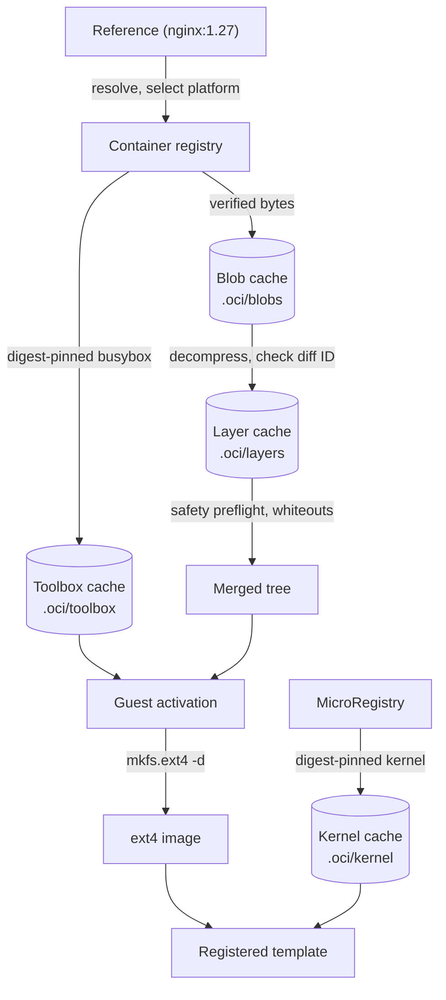

# OCI import pipeline

For inspect/import commands, see [OCI images](../guides/oci.md).
The API registers a template only after every import stage succeeds.

## Architecture

Each stage verifies its input and publishes its output atomically.

All caches live below `<FIRECRAB_IMAGE_ROOT>/.oci/` and are reverified on reuse.
Partial writes never use final paths.

## Blob cache

- Configs and layers are cached by SHA-256 at `<FIRECRAB_IMAGE_ROOT>/.oci/blobs/sha256/<hex>`.
- Entries hold the raw registry bytes, never decompressed data.
- Every lookup verifies size and digest; a corrupt entry is discarded and fetched again.
- One download is limited to 16 GiB (`FIRECRAB_OCI_MAX_BLOB_BYTES`).

## Layer decompression

- Plain, gzip, and zstd streams are decoded to `.oci/layers/sha256/<diff-id>/<compressed-digest>.<codec>.tar`.
- The manifest descriptor digest covers the registry bytes; the config `rootfs.diff_ids` entry covers the uncompressed tar.
- A tar is published only after its diff ID matches.
- Cache hits are rehashed; a corrupt entry is rebuilt from the verified blob.
- Output is limited to 64 GiB per layer (`FIRECRAB_OCI_MAX_UNCOMPRESSED_LAYER_BYTES`).
- At most two decoders run process-wide, each zstd window 128 MiB.

## Layer safety preflight

Every decompressed tar is scanned before extraction, reading GNU long-name/link metadata and PAX overrides.

- Member names are relative and free of parent components; only a directory may name the root as `.` or `./`.
- Character devices, block devices, and FIFOs are skipped; other special entries are rejected.
- Links must name a target; hard-link targets stay archive-root-relative.
- Regular whiteout files stay valid for the merge stage.

Rejected outright, stopping the import:

- Malformed headers, repeated PAX path/link records, sparse extensions.
- Missing end records and truncated member bodies.
- PAX `size` overrides, and global PAX path/link/size overrides.
- Any GNU or PAX metadata entry over 1 MiB.

Rejection keeps the verified blob and decompressed tar as cache entries.

## Layer merge

- Validated tars are consumed in manifest order.
- Each stream is reopened without following a cache-path symlink, then rechecked for size, `diff_id`, and archive safety.
- The staging tree keeps ordinary and sticky permissions, owned by the unprivileged API service.
- Image set-ID bits, numeric ownership, and extended attributes are not applied here; they belong to the ext4 stage.
- `.wh.<name>` removes the named sibling from lower layers; `.wh..wh..opq` removes lower-layer children of its directory.
- Whiteouts are applied before that layer's ordinary members, so a same-layer replacement survives and markers never appear.
- The tree is built as a private sibling and published atomically; the destination must not already exist.
- A failure removes the partial tree and retains verified blob and layer cache entries.

## Guest toolbox

Many container images have no init or DHCP client. A static BusyBox supplies utilities for every import and PID 1 when no supported native init is available.

- Taken from a digest-pinned busybox image, pulled through the same verified stages as the image being imported.
- Must be a 64-bit executable for this host with no dynamic loader recorded, because the merged tree has none to satisfy.
- Cached at `<FIRECRAB_IMAGE_ROOT>/.oci/toolbox/`, re-verified on every reuse, rebuilt when it no longer passes.
- `FIRECRAB_OCI_TOOLBOX_IMAGE` names a mirror; `FIRECRAB_OCI_TOOLBOX_PATH` names a program already on the host.

## Guest activation

The merged tree is inspected before provisioning. Detection follows guest symlinks
within the image; configuration directories alone do not identify an init system.

| Detected init | Activation |
| --- | --- |
| systemd executable in `/usr/lib/systemd/systemd` or `/lib/systemd/systemd` | Boots systemd; enables `firecrab-agent.service` and `firecrab-oci.service` in `multi-user.target` |
| OpenRC runner plus `openrc-init`, or an existing executable init with an OpenRC inittab | Boots OpenRC; enables `/etc/init.d/firecrab-agent` and `firecrab-oci` in the default runlevel |
| Neither, incomplete init installation, or distroless | Installs BusyBox at `/sbin/init` with a Firecrab inittab |

Native inittabs are preserved; `/sbin/init` selects native init when needed.
`/etc/firecrab/init-system` preserves this choice during VM specialization and prevents duplicate metrics/readiness setup.
Older imports retain their previous behavior until re-imported.
The toolbox is installed for every init path.
See [Guest runtime](guest-runtime.md) for mounts, metrics, app environment, and SSH.

Boot brings up the interface before DHCP and prints `FIRECRAB_NETWORK_READY` or `FIRECRAB_NETWORK_FAILED`.
Missing `ping`, `wget`, `vi`, and `nc` tools become BusyBox symlinks.
First boot installs packages through apt/dnf/apk/zypper/pacman and writes `base-packages.ok` only on success.
APT uses IPv4, bounded retries, and 600-second network-stage deadlines.
Dpkg configuration has no deadline; failure records `FIRECRAB_APT_FAILED` without the completion stamp.
DNF retries once after clearing metadata and disabling zchunk; signatures/checksums stay enabled.

The console uses agetty/login/bash when available, otherwise MOTD plus ash.
Native init respawns `firecrab-console`; systemd's serial/console getty units are masked.
An existing OpenRC ttyS0 service is retained.

For glibc guests, optional digest-pinned fastfetch is cached under `.oci/fastfetch/` and copied to `/usr/bin/fastfetch`.
`FIRECRAB_OCI_FASTFETCH_PATH` selects a host binary; absence is not an import failure.
Guest-path resolution stays inside the image, including symlinked `/etc` or `/sbin`.
Failed activation restores every modified path.

## Ext4 image

- The image is sized from the provisioned tree, not from a fixed length.
- Payload counts each regular inode once and includes symlink targets; hard links are not counted again.
- Size is payload plus a quarter for metadata plus 32 MiB headroom, rounded up to a mebibyte, never below 8 MiB.
- One image is limited to 32 GiB (`FIRECRAB_OCI_MAX_ROOTFS_BYTES`).
- Created sparse, formatted with `mkfs.ext4 -d`, published only after `tune2fs` shows free space remains.
- A full image, a failed format, or an existing destination is an error; the partial file is removed and the tree left in place.
- This stage pairs no kernel and registers nothing.

## Kernel and registration

The image is paired with a digest-pinned kernel for the host architecture.
Its `virtio_blk`, `virtio_net`, `virtio_mmio`, and `ext4` drivers are built in, so no initrd is required.
The verified cache is shared with [kernel management](../guides/kernels.md).
`FIRECRAB_OCI_KERNEL_PATH` can select a host copy that matches the pinned digest.
An unreachable registry can fall back to an installed catalog kernel.

The ext4 result is stored as `rootfs/<alias>.ext4` and registered as a local template.
This does not create a MicroRegistry catalog row.
Use [image registration](../guides/images.md#register) to create one.

## Related

- [Guest runtime](guest-runtime.md)
- [Storage](../guides/storage.md)
